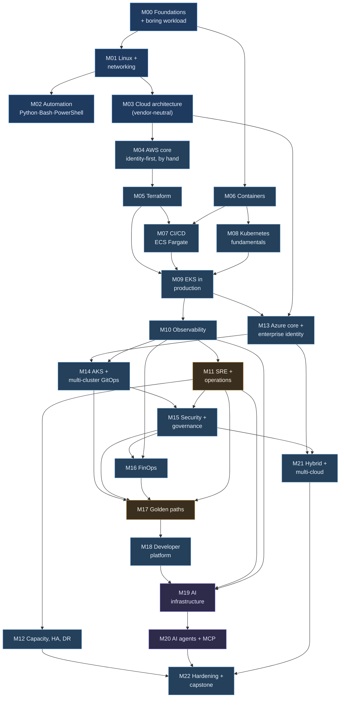

# Section 4 — Learning Dependency Map

Order matters more than content. The same set of topics taught in the wrong order produces an engineer who can repeat commands without being able to explain them: someone who writes Terraform for a VPC they have never reasoned about, or runs Kubernetes on a network they cannot debug. This section fixes the order and gives the reason behind each dependency, so that when you are tempted to skip ahead you know exactly what you would be skipping.

---

## 1. Your proposed chain, and what changes

Your draft:

```
Networking → Linux → Cloud fundamentals → IAM → Compute → Storage → Load balancing → Docker → Kubernetes
→ Terraform → CI/CD → Platform Engineering → Observability → Reliability → Security/Governance → FinOps → AI Infrastructure
```

It is a sensible instinct: foundations first and AI last. Seven changes turn it into a sequence that holds up when you are building one project across two years:

| # | Change | Why |
|:-:|---|---|
| 1 | **Linux and networking learned together**, not networking strictly first | You cannot practise networking without a host to practise on. `dig`, `ss`, `tcpdump` and `curl -v` *are* Linux tools. They are one phase with two halves ([M01](milestones/M01-linux-networking.md)). |
| 2 | **Vendor-neutral cloud architecture before any cloud** ([M03](milestones/M03-cloud-architecture.md)) | Regions, AZs, stateless design, queues, RTO/RPO: if you learn these as AWS product names first, you will learn Azure as a second vocabulary instead of a second implementation. |
| 3 | **IAM folded into the first cloud phase, identity-first** ([M04](milestones/M04-aws-core.md)) rather than after compute | Every resource you create needs an identity decision. Learning IAM after compute means retrofitting security, which is the habit the JD's "solutions meet architectural and security standards" line filters out. |
| 4 | **Terraform before Docker and Kubernetes**, and immediately after the hand-built cloud phase | Once you have clicked a VPC into existence once, every later piece of infrastructure should be code. If Kubernetes comes before Terraform, you build a cluster by hand and then have to unlearn it. |
| 5 | **Observability before platform engineering**, not after | A golden path must *ship* observability: dashboards, alerts and SLOs are created by the path. You cannot standardise something you have not built by hand at least once. |
| 6 | **Operations (SRE, incident/problem/change) straight after observability**, and security/governance/FinOps before platform engineering | Guardrails are the precondition for self-service. You cannot give developers autonomy safely until policy, tagging and cost allocation exist to constrain it. |
| 7 | **Second cloud (Azure) introduced mid-way**, after the core has been learned on AWS; **hybrid last** | You learn concepts once, on AWS, and then learn Azure as *differences* plus its enterprise control plane (Entra ID, management groups, Azure Policy, Arc). Hybrid needs both clouds and governance before it means anything. |

The resulting chain:

```
Engineering foundations → Linux + networking → Automation (Python/Bash/PowerShell) → Cloud architecture (neutral)
→ AWS core, identity-first → Terraform → Containers → CI/CD → Kubernetes fundamentals → EKS in production
→ Observability → SRE & operations → Capacity, HA & DR
→ Azure core & enterprise identity → AKS & multi-cluster GitOps
→ Security & governance → FinOps
→ Golden paths → Internal developer platform
→ AI infrastructure → AI agents & MCP
→ Hybrid & multi-cloud → Hardening & capstone
```

---

## 2. The graph



Amber nodes (**M11 operations, M17 golden paths**) are the two milestones you must never cut. They carry the JD's operational half ("Ensure that assigned incidents are resolved within agreed service levels… Own and manage changes") and its platform half ("building cloud-native platforms, internal developer tools, self-service portals"), and they are the two things almost no self-taught candidate can evidence.

---

## 3. Why each major topic precedes the next

| Before | After | The dependency, stated as a failure you avoid |
|---|---|---|
| Git, ADRs, the workload (M00) | Everything | Every later phase produces a commit, a decision record or a change to the workload. Without the habit in place, the evidence never exists. |
| Linux (M01) | Containers, Kubernetes | A container is a Linux process with namespaces and cgroups. An engineer who does not know what `SIGTERM`, exit code 137 or an inode is will read `CrashLoopBackOff` as a mystery instead of a symptom. |
| Networking (M01) | Cloud, Kubernetes, hybrid | VPCs, security groups, NAT, private endpoints, Gateway API and VPNs are all CIDR, routing, DNS and TLS in different forms. Networking is the most common cause of real incidents and the hardest skill to pick up from a tutorial. |
| Automation (M02) | Cloud | Cloud work quickly becomes scripting against APIs: pagination, throttling, retries, idempotency. Learn those on something cheap first. |
| Neutral architecture (M03) | AWS, then Azure | If you know *why* an AZ exists, a second cloud is a translation exercise. If you only know *where the button is*, it is a second curriculum. |
| AWS by hand (M04) | Terraform (M05) | Terraform written by someone who has never built the resource by hand is Terraform they cannot debug. The manual build log becomes the specification for the code. |
| IAM (M04) | Everything after | CI federation, Pod Identity, cross-cloud federation, policy, the read-only agent: all of them are identity problems. Identity is the trust model of the whole platform. |
| Terraform (M05) | CI/CD, EKS | A pipeline that deploys infrastructure needs infrastructure as code. An EKS cluster built by clicking cannot be upgraded, rebuilt or reviewed. |
| Containers (M06) | CI/CD, Kubernetes | Pipelines exist to build and promote an artefact. Kubernetes exists to run one. Build the artefact first. |
| CI/CD on ECS (M07) | EKS (M09) | You learn release engineering (promote by digest, rollback, migrations) on a simpler runtime. When you migrate to EKS, the only new variable is Kubernetes itself. The ECS→EKS migration is also a real change-management exercise. |
| Kubernetes locally (M08) | EKS (M09) | Do not pay for the control plane while you learn what a pod is. Pay for what only a cloud cluster teaches: VPC CNI IP exhaustion, Pod Identity, Karpenter, the load balancer controller, upgrades. |
| EKS (M09) | Observability (M10) | Observability needs something distributed and failable to observe: several services, queues, nodes and a database. |
| Observability (M10) | Operations (M11) | An incident against a system with no telemetry is just confusion. Detection must come from an alert, not from you knowing what you broke. |
| Operations (M11) | Capacity/HA/DR (M12) | Capacity and continuity are ITIL processes too. They need the incident and change discipline, the severity matrix and the templates already in place. |
| AWS + K8s depth (M09) | Azure (M13) | Azure is learned as differences: RBAC versus IAM policy JSON, NSG versus SG, subscription versus account, private endpoints and private DNS, Entra ID. That only works once the concepts are yours. |
| Azure + AKS (M13–M14) | Security & governance (M15) | Governance is multi-cloud in this JD ("security, governance, resilience, FinOps" across AWS and Azure). SCPs and Azure Policy are best learned side by side. |
| Governance (M15) | FinOps (M16) | Cost allocation depends on tags, and tags only exist if policy enforces them. |
| Security, governance, FinOps, operations | Golden paths (M17) | **Guardrails are what let you grant autonomy.** A path that provisions infrastructure without policy, tagging, cost allocation and standard alerts is a faster way to create unmanaged sprawl. |
| Golden paths (M17) | Developer platform (M18) | A portal is a front door to a path. A portal with no path behind it is a ticket system in a nicer interface. |
| Everything operational | AI infrastructure (M19) | An AI service is a workload with unusual failure modes (429s, variable latency, per-token cost, untrusted output). Operating it uses every earlier skill; only the failure modes are new. |
| AI infrastructure (M19) | Agents & MCP (M20) | An operations agent is only useful once you have worked around twenty incidents by hand and know which queries you always run first. That knowledge is its specification and its baseline. |
| Both clouds + governance | Hybrid (M21) | "Unify control across datacentres, networks, public and private cloud" means governing all three with one policy set, so both clouds and the policy work must exist first. |

---

## 4. What can be pulled forward

Use these when life interrupts the plan: a month with no cloud budget, a travel week, a work crunch.

| Milestone | Can start after | Use it when |
|---|---|---|
| M06 Containers | M00 | Cloud spend has to pause: containers are local and free. |
| M08 Kubernetes fundamentals | M06 | Same reason. `kind`/`k3d` cost nothing. |
| M02 Automation | M00 (partially) | You are travelling. Scripting practice needs only a laptop. |
| M16 FinOps (tagging, budgets) | M05 | A cost incident happens early. Budgets exist from M04 anyway; this pulls the full allocation model forward. |
| M21 Hybrid | M15 | You want the "datacentre" story before AI, or AI budgets are constrained. It has no dependency on M19–M20. |

## 5. What can be cut, and what that costs you

In order, safest cut first:

| Cut | You lose | You keep |
|---|---|---|
| M21's VPN and hybrid DNS windows | Hands-on cross-cloud and on-prem connectivity. You can still explain it. | Arc/SSM projection and a policy that governs the "datacentre". |
| M18's portal UI (keep the PR-generating API) | Visible evidence of the "self-service portals" and full-stack requirements | The self-service *mechanism* |
| M19's self-hosted inference lab | First-hand managed-versus-self-hosted numbers | The AI gateway, routing, fallback, cost control |
| M12's pilot-light region rebuild (keep PITR and a same-region rebuild) | A tested region-loss procedure | Measured RTO/RPO for the realistic case |
| M20 reduced to four tools and a five-case eval set | Breadth of the agent | The read-only guarantee and the injection test, which are the parts that matter |

**Never cut:** M01 (every later incident depends on it), M05 (everything downstream is code), **M11** and **M17**. You will be most tempted to cut these two because neither produces an impressive screenshot. Extend the timeline before you cut either.

→ Next: [Section 5 — Production Project Proposal](05-production-project-proposal.md)
