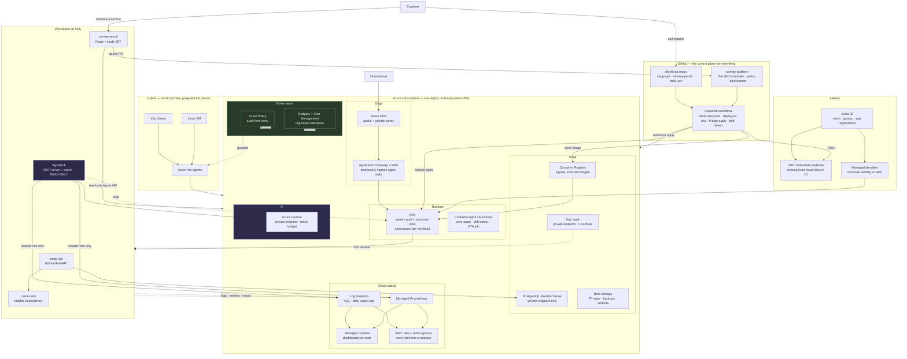

# Step 6 — The Architecture

## 1. Target architecture

## 2. Why each component exists

The test every component had to pass: **name the JD requirement it satisfies, or the failure it prevents.** Anything that could not answer is in §4, deleted.

### Identity and access

| Component | Why it exists |
|---|---|
| **Entra ID** | The identity source of truth. Portal SSO, RBAC assignments, group-based access. The JD's enterprise context makes this non-negotiable — and it is the concept that transfers to every other cloud. |
| **OIDC federated credentials for CI** | So no Azure secret ever exists in GitHub. This is the single highest-value security control in the whole design, and the one that most tutorials get wrong by using a long-lived service principal secret. |
| **Workload identity on AKS** | Pods authenticate to Azure as themselves. No connection strings in manifests. Directly evidences "security best practices". |
| **Key Vault + CSI Secrets Store driver** | Secrets have a lifecycle: rotation, versioning, access audit. Mounting them via CSI means the app never sees the vault. Enables the "expired secret" failure drill. |

### Network and edge

| Component | Why it exists |
|---|---|
| **VNet, subnets, NSGs, route tables** | The substrate for every networking incident you will diagnose. Hub-and-spoke because it is what enterprises use and because it makes the *why* of routing visible. |
| **Private endpoints** (Postgres, Key Vault, ACR, Azure OpenAI) | Removes public exposure of stateful services. Also the cause of the most instructive failure in the whole roadmap: private DNS misconfiguration, where everything looks correct and nothing resolves. |
| **Azure DNS, public + private zones** | Name resolution is the most common real cause of "the app is down". You need both halves to experience split-horizon DNS. |
| **Application Gateway + WAF** | L7 termination, TLS, and a WAF rule set. Expensive, so it runs in timeboxed windows; `ingress-nginx` with a standard load balancer is the daily driver. Both exist so you can explain the trade-off. |
| **ingress-nginx** | Kubernetes-native L7 routing, the thing you actually operate day to day, and where you will debug a 502 that is not the application's fault. |

### Compute and runtime

| Component | Why it exists |
|---|---|
| **AKS** | The JD names Kubernetes. More importantly, operating one cluster teaches scheduling, resource governance, rollouts, probes, autoscaling and upgrades — a dense cluster of P0 skills. System pool + spot user pool because node pool strategy and spot eviction are real operational topics. |
| **Container Apps / Azure Functions** | The JD names serverless. They host the three things that genuinely should not be pods: the scheduled cost report, the nightly Terraform drift detector, and `cargo-api`'s ETA recompute job. Choosing correctly between these and AKS is `ADR-002`. |
| **Azure Container Registry** | Build once, promote by digest. Scanning and SBOM live here. A registry you own is what makes "the artifact tested in dev is bit-identical to the one in prod" true rather than aspirational. |

### State

| Component | Why it exists |
|---|---|
| **PostgreSQL Flexible Server** | Real managed data: backups, point-in-time restore, connection limits, maintenance windows, failover. Half the DR curriculum lives here. Burstable tier, stopped between sessions. |
| **Blob Storage** | Terraform remote state with locking (the thing that makes IaC a team activity), plus database dumps and pipeline artifacts. Lifecycle policies and redundancy tiers are a cheap, real lesson. |

### Observability

| Component | Why it exists |
|---|---|
| **Log Analytics + KQL** | Centralised logs and the query language an Azure operator is expected to know. The daily ingest cap is deliberate: log cost is a real production problem and you should meet it on a small bill. |
| **Managed Prometheus + Managed Grafana** | Metrics in the open standard rather than a proprietary one, so the skill transfers. Dashboards stored as code in `platform/observability/`, not clicked. |
| **OpenTelemetry in the workloads** | Traces across portal → API → database → external dependency. The only way to answer "which of these six hops made it slow". |
| **Alert rules + action groups** | Alerts are the input to the operational half of the JD. The rule is absolute: no alert exists without a runbook. |

### Governance and cost

| Component | Why it exists |
|---|---|
| **Azure Policy** | "Governance" is an explicit requirement. Policies you author — required tags, denied public IPs, allowed regions, allowed VM sizes, HTTPS-only storage — rolled out audit-first and then to deny. Also applied to the Arc-connected resources, which is the hybrid control story the team description describes. |
| **Budgets + Cost Management + tagging taxonomy** | "Cost awareness" is explicit, and your own $30–60 budget makes it real. Tags are what make per-service cost attribution possible, which is what makes the portal's cost view possible. |

### Hybrid

| Component | Why it exists |
|---|---|
| **Azure Arc over a local k3s cluster and a local VM** | Directly addresses "unify control across datacentres, networks, public and private cloud environments" — the most distinctive line in the posting. Arc for servers and Arc-enabled Kubernetes have no per-resource charge for the basics, so this is nearly free and disproportionately differentiating. |

### AI

| Component | Why it exists |
|---|---|
| **Azure OpenAI behind a private endpoint** | The JD's AI desirable, framed as the JD frames it: *integration*. Private endpoint, Entra auth, token budget, latency and cost telemetry. |
| **Flightdeck MCP server** | "MCP integrations" is named explicitly. A read-only MCP server over your own telemetry is the most defensible demonstration of it: it is useful, it is bounded, and you can explain every safety decision. |
| **Reader-only identity for Flightdeck** | The architectural expression of "the AI agent must not change infrastructure". Not a prompt instruction — an RBAC assignment, and a test that asserts no write-capable tool is registered. |

## 3. Request paths worth being able to draw from memory

Interviewers ask you to trace a request. Practise these three until you can draw them on a whiteboard without hesitating.

1. **User request:** browser → Azure DNS → Application Gateway (TLS termination, WAF) → AKS internal LB → ingress-nginx → Service → Pod (`runway-portal` BFF) → token from workload identity → Azure Resource Graph / Log Analytics → response. *Failure points: DNS record, certificate expiry, WAF false positive, NSG, ingress rule, readiness probe, RBAC scope.*
2. **Deployment:** PR merged → GitHub Actions → OIDC token exchange with Entra → build image → scan → push to ACR by digest → deploy to dev → smoke test gate → manual approval → deploy to prod by the same digest → rollout status watched → automatic rollback on failure. *Failure points: OIDC trust, image pull secret, policy deny, resource quota, failed probe, migration ordering.*
3. **Incident investigation:** alert fires (symptom-based) → action group notifies → runbook opened → Grafana dashboard → Log Analytics KQL → trace waterfall → recent-changes check → hypothesis → mitigation → verification → incident record → RCA. *This is the path Flightdeck later compresses, and you must be fast at it manually first.*

## 4. Deliberately excluded, and why

| Excluded | Reason |
|---|---|
| Service mesh (Istio/Linkerd) | Solves problems you do not have at three services. Large operational cost. Not in the JD. You should be able to explain *what it would give you* — that is the required depth. |
| Argo CD / Flux | GitOps is worth learning, but only after plain push-based pipelines are second nature. Optional extension in Milestone 13. |
| Multi-region active-active | Cost and complexity far beyond the learning value. Replaced by a *tested* single-region rebuild with a measured RTO — which is what most enterprises genuinely have. |
| Azure Firewall as a permanent fixture | ~$900/month. NSG + UDR reasoning teaches the same network concepts. One optional timeboxed exercise if you want the hands-on. |
| API Management | Genuine enterprise component, but Application Gateway + ingress already cover the L7 concepts you need, and APIM adds cost without adding a JD requirement. |
| Kafka / Event Hubs | The queueing lesson is delivered by a much cheaper worker + queue. No JD requirement. |
| A second cloud in the main architecture | Milestone 13 ports one module to AWS. Keeping the main system single-cloud is what makes depth possible. |
| Front Door / CDN | No global user base. Would be decoration. |

Being able to list this table in an interview is worth as much as the architecture itself. Senior engineers are identified by what they chose *not* to build.

→ Next: [Step 7 — The learning path, Phases 0–5](06-learning-path-phases-00-05.md)
