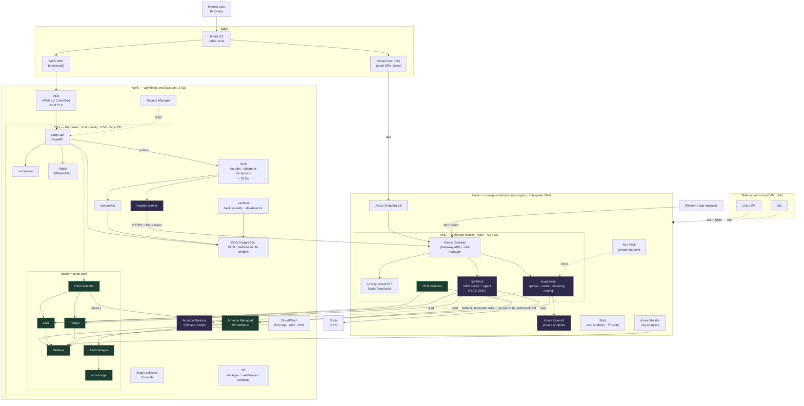
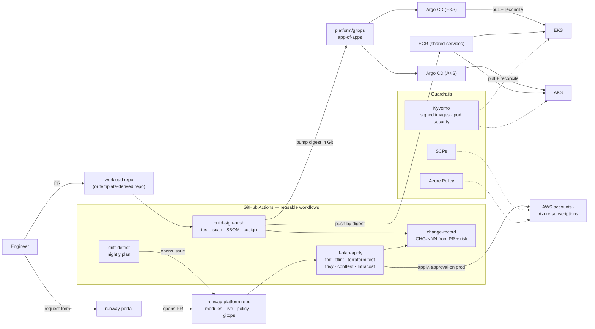
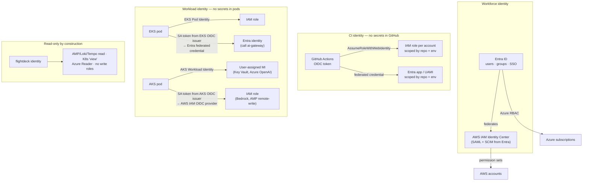

# Section 6 — Final Project Architecture

This is Runway at v6 (month ~24). You do not build it all at once: [Section 5 §5](05-production-project-proposal.md#5-evolution-how-runway-grows) shows how it grows. Three views, because one diagram of a real platform is either unreadable or dishonest:

1. **Runtime view**: how a request and a job flow through the system
2. **Delivery / control-plane view**: how a change reaches production
3. **Identity / trust view**: who can call what, and with which credential (the answer is always "a federated one")

---

## 1. Runtime view

## 2. Delivery and control-plane view

Two properties to state in an interview:

- **CI never holds cluster credentials.** From M14, pipelines write the desired state to Git and Argo CD pulls it. Deploys are reviewable, auditable and continuously reconciled. Drift in a cluster is corrected, not discovered months later.
- **Terraform still runs from the pipeline, not from Argo.** Cloud infrastructure (accounts, networks, clusters, databases) and in-cluster state have different lifecycles and different blast radii. Mixing them is a common, expensive mistake (ADR-018).

## 3. Identity and trust view

**The rule the whole diagram expresses:** there is no long-lived credential anywhere in the platform: not in GitHub, not in a pod, not across the cloud boundary. Every hop is a short-lived token issued by one identity system and trusted by another under explicit conditions (issuer, subject, audience). When one of those conditions is wrong you get [S25](10-failure-and-troubleshooting.md), which is one of the most instructive incidents in the roadmap.

---

## 4. Why each component exists

The test every component had to pass is the same one: **name the JD requirement it satisfies, or the failure it prevents.**

### Edge and traffic

| Component | Why it exists |
|---|---|
| **Route 53 public zone + ACM** | Name resolution and TLS are where real outages start (S01, S03). You need a real domain and real certificates to meet them. |
| **CloudFront + S3 for the portal SPA** | A static SPA belongs on a CDN, not in a pod. Teaches cache behaviour, invalidation and origin separation (static on AWS, API on Azure) cheaply. |
| **ALB via AWS Load Balancer Controller** | The EKS-native L7 entry: Kubernetes objects provision a cloud load balancer. You will debug target group health, security groups on targets and deregistration delay during rollouts. |
| **AWS WAF (timeboxed)** | L7 protection and the false-positive problem. It runs in two windows (M15, M22) to control cost. |
| **Envoy Gateway (Gateway API) on AKS** | A portable, in-cluster gateway, deliberately different from the EKS approach so you can argue the trade-off. Also the successor pattern to the retired ingress-nginx (ADR-009). |

### Runtime

| Component | Why it exists |
|---|---|
| **EKS** | The JD names it. It is the less-managed Kubernetes: VPC CNI and IP exhaustion, Pod Identity, the LB controller and Karpenter are all yours to operate. It hosts the transactional system and the shared platform services. |
| **AKS** | The JD names it. Operated as the *second* cluster, focusing on what differs: Azure CNI overlay, Workload Identity, node auto-provisioning, private endpoints, and the upgrade model. |
| **Karpenter (EKS)** | Right-sized, just-in-time nodes, spot handling and consolidation. The capacity and cost behaviour you must be able to explain (ADR-010). |
| **Argo CD (both clusters)** | Pull-based, multi-cluster delivery with continuous reconciliation (ADR-018). |
| **External Secrets Operator** | One secret-delivery pattern with two backends (Secrets Manager, Key Vault). Rotation without redeploying (ADR-011). |
| **Lambda (`backup-verify`, `idle-detector`)** | Short, scheduled, stateless jobs are exactly what FaaS is for. No always-on compute for a five-minute nightly task. |

### State

| Component | Why it exists |
|---|---|
| **RDS PostgreSQL** | Real managed data: backups, PITR, parameter groups, connection limits, maintenance windows, Multi-AZ failover, major-version upgrades (an EOL exercise). Half the continuity curriculum lives here. |
| **Redis** | Cache for the read-heavy tracking endpoint, and counters for `ai-gateway` rate limits and quotas. Runs in-cluster for cost; the ADR states that production would use ElastiCache or Azure Managed Redis. |
| **SQS + DLQs** | Decouples slow or variable work (ETA recompute, AI summaries) from request latency. Teaches backpressure, visibility timeouts and poison messages. |
| **S3 / Azure Blob** | Terraform state (S3 with native locking, Blob with leases), backups, telemetry storage, artefacts. Lifecycle policies are a cheap FinOps lesson. |

### Observability and operations

| Component | Why it exists |
|---|---|
| **OpenTelemetry (SDK + Collector)** | One instrumentation standard across Python, Node and both clouds. Swapping the backend does not mean re-instrumenting. |
| **Amazon Managed Prometheus** | Metric history that survives `make down`. The SLO history is the evidence of operating over months. |
| **Loki + Tempo (S3-backed) + Grafana** | Logs and traces cheaply, dashboards and alerts as code, one pane over both clouds plus CloudWatch and Azure Monitor. |
| **Alertmanager + `ems-bridge`** | Alert routing by `tier` (L1 or L2) and severity, with incident records created automatically. The JD's EMS requirement made concrete. |
| **CloudWatch / Azure Monitor** | Provider-level signals the cluster cannot see (flow logs, RDS, Activity Log, Azure OpenAI). They are also the fallback when the observability stack itself is down in a DR drill. |

### Governance, cost, platform

| Component | Why it exists |
|---|---|
| **SCPs, Azure Policy, conftest, Kyverno** | Four enforcement points, each catching a different class of failure at a different time (ADR-019). |
| **Budgets, anomaly detection, FOCUS exports, OpenCost, `finops-collector`** | Cost per service and per team across two bills and two clusters. Showback in the portal (ADR-020). |
| **Golden path + `workload` module + template repo** | Onboarding in hours, with compliance as a side effect of using the path (ADR-021). |
| **`runway-portal`** | The self-service front door. Every request becomes a PR (ADR-022). |
| **Service and data catalogues** | Ownership, dependencies, data classification, retention and RPO in one place, as the JD requires. |

### AI

| Component | Why it exists |
|---|---|
| **`ai-gateway`** | One governed path for every team to reach models: authentication, quotas, metering, caching, timeouts and cross-cloud fallback. It is platform engineering applied to AI (ADR-023). |
| **Azure OpenAI (private endpoint, managed identity)** | The enterprise-typical primary: private data path, Entra auth, regional deployment, TPM/RPM quota model. |
| **Amazon Bedrock (fallback)** | A second provider with a different quota pool. It turns "the model is rate-limited" from an outage into a degradation. |
| **`flightdeck`** | The JD's "AI agents" and "MCP integrations", delivered read-only, audited and measured (ADR-025). |

### Hybrid

| Component | Why it exists |
|---|---|
| **Local VM + k3s via Azure Arc and SSM hybrid activation** | "Unify control across datacentres … public and private cloud". The same tags, policy and inventory across non-cloud resources, at almost no cost. |
| **Site-to-site VPN AWS↔Azure, hybrid DNS resolvers (timeboxed)** | Private routing and name resolution across boundaries, which is where hybrid actually breaks (S34). Timeboxed because gateways and resolver endpoints bill hourly. |

---

## 5. Major decisions: Problem → Options → Decision → Trade-offs

Each of these is a full ADR in `docs/adr/`. This is the one-screen version you should be able to say out loud.

| ADR | Problem | Options | Decision | Trade-offs accepted |
|---|---|---|---|---|
| 002 | JD requires both clouds; learning both at once halves depth | Azure first · AWS first · both in parallel | **AWS first, Azure second** | Azure (the likely enterprise default) arrives at month ~14. Mitigated: Entra becomes the workforce IdP and Azure is operated for 10 months. |
| 003 | Many accounts need consistent guardrails | Control Tower · raw Organizations + Terraform · single account | **Organizations + OUs + SCPs in Terraform** | More work than Control Tower, but every control is visible and reviewable. Control Tower is taught conceptually. |
| 004 | Cross-cloud and on-prem routing needs non-overlapping space | Ad hoc CIDRs · planned supernets | **AWS 10.10/16 dev, 10.20/16 prod, Azure 10.30/16, on-prem 10.40/16** | Up-front planning. Overlap discovered later is almost impossible to fix. |
| 005 | State must be shared, locked, isolated | One state · workspaces · directory per env/component · Terragrunt | **Directory per `<cloud>/<account>/<env>/<component>`; S3 native locking; Azure Blob leases** | More roots to manage. In return: small blast radius and fast plans. |
| 007 | First containerised runtime for CI/CD | EC2 · ECS Fargate · straight to EKS | **ECS Fargate first** | You migrate later. That is intentional: the migration is itself the lesson. |
| 008 | Many services, multi-cloud, platform add-ons | Stay on ECS · EKS | **Migrate to EKS with weighted target groups, zero downtime** | Higher operational load. Accepted because the JD names EKS/AKS and the platform needs Kubernetes-level extensibility. |
| 009 | Traffic entry; ingress-nginx is retired | ingress-nginx · ALB via LB Controller · Envoy Gateway · cloud-native gateway on AKS | **ALB on EKS; Envoy Gateway (Gateway API) on AKS** | Two patterns to operate, chosen on purpose so you can compare them. An EOL replacement exercise comes with it. |
| 010 | Node capacity that follows demand | Cluster Autoscaler · Karpenter · EKS Auto Mode | **Karpenter** | More to operate than Auto Mode, but you understand every scaling decision. Auto Mode is documented as what you might choose at work. |
| 011 | Secrets in pods without static credentials | CSI driver · ESO · app SDK | **ESO on both clusters** | One more controller, but one pattern everywhere. |
| 012 | One view across two clouds; survive teardown | Native only · SaaS · self-hosted LGTM + AMP | **OTel + AMP + Loki/Tempo on S3 + Grafana; native kept** | The stack lives in the AWS blast radius; native tools are the documented fallback. |
| 013 | Alerts must route to the right tier and become records | Email everything · tiered routing + EMS bridge | **L1/L2 taxonomy, Alertmanager routes, `ems-bridge` issues** | Taxonomy upkeep. Without it, alerts get muted. |
| 014 | Continuity within budget | Multi-region active-active · warm standby · pilot light · backup-restore · cross-cloud DR | **Backup-restore + pilot light in a second AWS region** | RTO is measured in tens of minutes, not seconds. It is honest, tested and affordable. Cross-cloud DR rejected on data gravity and complexity. |
| 015 | Why use two clouds at all | Everything on AWS · split by service affinity · duplicate | **Transactional on AWS; identity-facing and AI on Azure** | Cross-cloud latency and egress on the AI path. It is async, so latency is tolerable, and egress is measured. |
| 016 | One workforce identity | Separate IdPs · Entra → IAM Identity Center | **Entra ID as source, SAML + SCIM to AWS** | A migration mid-project. Treated as a planned change with rollback. |
| 017 | Cross-cloud calls without keys | Static keys in secret stores · federation | **OIDC federation both directions** | Trust conditions are subtle (S25). Worth it: no credential to leak or rotate. |
| 018 | Deploying to two clusters safely | Push from CI · Argo CD · Flux | **Argo CD per cluster, app-of-apps in Git** | Another control plane to run and upgrade. Accepted: pull model, no cluster credentials in CI, reconciliation. |
| 019 | Where to enforce policy | One point · several | **conftest (PR), SCP/Azure Policy (API), Kyverno (admission)** | Duplicated intent across engines. Each catches what the others cannot. |
| 020 | Cost attribution across two bills and shared clusters | Tags only · FOCUS + OpenCost | **Tags enforced by policy + FOCUS normalisation + OpenCost** | Shared-cost allocation is always an approximation. The rule is documented. |
| 021 | Onboarding must not need the platform team | Docs + copy-paste · templates + module contract | **`workload.yaml` → `workload` module, versioned** | Abstractions leak (S30). Escape hatches are documented. |
| 022 | Self-service front door | Backstage · custom thin portal · no portal | **Custom thin portal, Backstage-compatible catalogue** | Less plugin ecosystem, but more learning and direct evidence of full-stack work. Migration stays cheap. |
| 023 | Teams need governed model access | Direct SDK calls · adopt LiteLLM / Envoy AI Gateway / APIM · build | **Build a thin gateway to learn; ADR names what you would adopt at work** | Reinventing some wheels, on purpose, for learning. |
| 024 | Managed or self-hosted models | Managed only · self-host · hybrid | **Managed in production; self-hosted CPU lab for numbers** | No GPU operations depth. That is out of scope for the JD. |
| 025 | An agent near production must not act | Prompt instructions · architectural limits | **Identity + tool surface + audit, all independent** | Less "magic". The value is shorter investigation, not remediation. |
| 026 | Datacentre integration | Permanent VPN · timeboxed VPN + Arc/SSM | **Arc/SSM always on; VPN/resolvers timeboxed** | No permanent private hybrid path in the lab. Documented honestly. |

---

## 6. Request paths to know by heart

Interviewers ask you to trace a request. Practise these until you can draw them on a whiteboard, including the failure points, without hesitating.

**Path 1: user reads a shipment (synchronous, AWS).**
Browser → Route 53 → (WAF) → ALB (TLS, ACM) → target group → pod IP (VPC CNI) → `cargo-api` → Redis (cache hit returns) → RDS on a miss → response. Trace spans at every hop go to Tempo.
*Failure points:* DNS record (S01), certificate (S03), SG on targets (S02), target health/readiness (S10, S12), cache stampede, connection pool (S18), CPU throttling (S19).

**Path 2: portal request for a new service (self-service).**
Browser → CloudFront (SPA) → `/api` → Azure LB → Envoy Gateway → portal BFF (Entra SSO, PKCE) → GitHub API opens a PR against `runway-platform` containing a `workload.yaml` → `tf-plan-apply` runs policy checks and posts plan + cost → review → merge → apply → Argo CD syncs namespace, identity, gateway route, dashboards and alerts → catalogue updated.
*Failure points:* token audience, GitHub App permissions, conftest deny (S28), module version mismatch, leaky abstraction (S30).

**Path 3: cross-cloud async AI summary.**
`cargo-api` records a shipment exception → publishes to SQS `shipment-exceptions` → `insights-worker` (EKS) receives → exchanges its projected service-account token (EKS OIDC issuer) for an Entra token via federated credential → HTTPS to AKS Envoy Gateway → `ai-gateway` validates the token and checks the team quota in Redis → cache lookup → Azure OpenAI over the private endpoint (managed identity) with timeout → **on 429/timeout:** circuit breaker opens → Bedrock via AKS-issuer → IAM federation → **on failure:** non-AI fallback (rule-based category) → structured output validated against schema → metered (tokens, cost, prompt/model version) → response → worker writes to RDS → message deleted. On repeated failure → DLQ → alert.
*Failure points:* federation subject/audience (S25), private endpoint DNS (S24), 429 and retry storm (S31), cost spike (S32), schema validation failure, visibility timeout shorter than the call (the message is processed twice).

**Path 4: a change reaching production.**
PR → `build-sign-push` (tests, scan, SBOM, cosign) → image to ECR by digest → change record `CHG-NNN` generated with risk score → promotion PR bumps the digest in `platform/gitops/` for dev → Argo CD syncs → smoke and k6 gates → promotion PR for prod (approval, freeze-calendar check) → Argo CD syncs prod → Kyverno verifies the signature at admission → rollout watched against SLO burn → rollback is a Git revert.
*Failure points:* OIDC trust (S04), unsigned image rejected, migration ordering (S11), green pipeline with a broken service (S10), OutOfSync/Degraded (S26), failed change (S35).

**Path 5: incident investigation.**
Symptom-based SLO burn alert → Alertmanager routes by tier → `ems-bridge` opens an incident record → runbook link → Grafana (RED dashboard) → Tempo trace → Loki logs by `trace_id` → recent changes (Argo history, change records) → hypothesis → mitigation → verification on the same signal → record completed → problem record if it recurs. *This is the path Flightdeck later compresses. You must be fast at it by hand first.*

---

## 7. Deliberately excluded, and why

| Excluded | Reason |
|---|---|
| Service mesh (Istio/Linkerd) | Solves mTLS, traffic shifting and L7 telemetry for large fleets. At three services it is pure operational cost. You should be able to explain what it would give you. |
| Multi-region active-active | Cost and complexity far beyond the learning value. A tested pilot light with a measured RTO is what most enterprises actually have. |
| Cross-cloud DR | Data gravity (the database is on AWS), egress cost, and doubled operational surface. The honest answer to "why not?" is worth more than a demo that is never tested. |
| EKS Auto Mode / fully managed node lifecycle | Hides exactly what you are trying to learn. Documented as a legitimate production choice in ADR-010. |
| Azure API Management / Front Door / Azure Firewall as permanent fixtures | Genuine enterprise components with meaningful fixed monthly cost. Their concepts are covered by Gateway API, CloudFront, NSG/UDR and the ADRs. |
| Kafka / Event Hubs | SQS teaches the queueing lessons. There is no JD requirement. |
| Managed Redis | Cost. In-cluster Redis teaches the concepts, and the ADR states the production choice. |
| Permanent GPU node pools | Out of scope for the JD and the budget. One optional one-day lab. |
| Custom operators | You understand the reconcile loop. Writing controllers is a different career direction. |
| Backstage | Evaluated, not adopted (ADR-022). The catalogue format is compatible, so adopting it later is cheap. |

Being able to talk through this table in an interview is worth as much as the architecture itself.

→ Next: [Section 7 — Phase-by-Phase Learning Roadmap](07-phase-roadmap.md)
