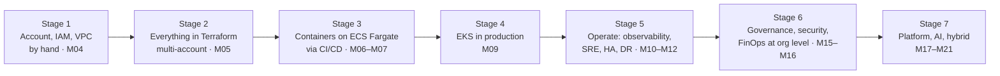

# Section 11 — AWS Learning Path

AWS is your **first** cloud. Everything in this file is the AWS spine of the roadmap: what you learn, in what order, what you build with it, and how you know you are ready for the next stage. The detail of each stage lives in the milestone files; this document shows how they connect.

> JD evidence: *"Proficiency in managing and operating **AWS** and **Azure** cloud platforms"* · *"Experience operating **large public cloud footprints** and onboarding applications using governed and automated DevOps practices"* · *"Amazon EKS"* · *"AWS Certified Solutions Architect – Professional · AWS Certified DevOps Engineer – Professional"*.

---

## 1. Why AWS first (summary of ADR-002)

| Reason | What it means for your learning |
|---|---|
| **The primitives are explicit and unforgiving** | In a VPC you create the internet gateway, the NAT gateway, every route table and every security group yourself. Nothing is routed for you. You learn networking mechanically because AWS makes you. |
| **IAM is a policy language, not a role picker** | IAM policy JSON, trust policies, permission boundaries, SCPs and the policy-evaluation logic force you to reason about *why* a call was allowed or denied. That reasoning transfers to every other cloud. |
| **EKS is the less-managed Kubernetes** | VPC CNI IP exhaustion, Pod Identity vs IRSA, the AWS Load Balancer Controller, Karpenter — you operate more of the cluster yourself, which teaches more. |
| **Two of the three named certifications are AWS Professional** | SA Pro and DevOps Pro. Depth in AWS pays twice. |
| **Azure's strengths arrive where they are strongest** | Entra ID, management-group governance, Arc and Azure OpenAI map onto the governance, platform, hybrid and AI phases (M13 onward). See [Section 12](12-azure-learning-path.md). |

The honest counter-argument — large regulated enterprises are often Microsoft-heavy, PowerShell is named, Entra ID is the identity source of record — is real. It is mitigated by making Entra ID the workforce identity provider from [M13](milestones/M13-azure-core.md) onward and by ten months of Azure operation before the roadmap ends.

**Rule:** learn the concept first (see [Appendix A1](appendix/A1-cloud-architecture-concepts.md)), then the AWS implementation, then later the Azure *difference*. Never learn a service as a console location.

---

## 2. The progression at a glance



| Stage | Milestones | ≈ Months | AWS depth you leave with (L-scale, §24) |
|---|---|:--:|---|
| 1 — Foundations by hand | [M04](milestones/M04-aws-core.md) | 4–5 | L2: can build a VPC, EC2, ALB, RDS by hand and explain every piece |
| 2 — Infrastructure as code | [M05](milestones/M05-terraform.md) | 5–6 | L3: nothing exists outside Terraform; multi-account structure in code |
| 3 — Containers and delivery | [M06](milestones/M06-containers.md), [M07](milestones/M07-cicd.md) | 6–8 | L3: ECR, ECS Fargate, OIDC from GitHub, build-once-promote |
| 4 — EKS | [M09](milestones/M09-eks.md) | 9–10 | L3→L4: EKS you can upgrade, scale and diagnose |
| 5 — Operating it | [M10](milestones/M10-observability.md)–[M12](milestones/M12-capacity-ha-dr.md) | 11–14 | L4: CloudWatch, AMP, Multi-AZ, backups, measured RTO/RPO |
| 6 — Organisation-level control | [M15](milestones/M15-security-governance.md), [M16](milestones/M16-finops.md) | 16–18 | L4: SCPs, Config, Security Hub basics, Cost Anomaly Detection, FOCUS exports |
| 7 — Platform, AI, hybrid | [M17](milestones/M17-golden-paths.md)–[M21](milestones/M21-hybrid-multicloud.md) | 19–23 | L4→L5: account vending, Bedrock fallback, SSM hybrid, VPN |

---

## 3. Service areas in learning order

Each row: the concept you are learning, the AWS services that implement it, and what you build in Runway with it.

### Stage 1 — Identity-first foundations ([M04](milestones/M04-aws-core.md))

| Concept | AWS services | What you build | Depth expected |
|---|---|---|---|
| Account as security and billing boundary | AWS account, AWS Organizations, OUs | `management`, `security`, `shared-services`, `workloads-dev`, `workloads-prod`, `sandbox` (created by hand here, codified in M05) | Explain why accounts, not tags, are the blast-radius boundary |
| Human access without long-lived keys | IAM Identity Center (built-in directory at first), permission sets | `PlatformAdmin`, `Developer`, `ReadOnly` permission sets | Root user locked with MFA and never used again |
| Authorisation | IAM policies (identity, resource, trust), permission boundaries, SCPs | A least-privilege role for `cargo-api` derived by trial: start at zero, add what fails | Explain the policy-evaluation logic: explicit deny → SCP → resource → boundary → identity |
| Private network | VPC, subnets (public / private / data across 3 AZs), IGW, NAT gateway, route tables | The VPC from ADR-004's CIDR plan (10.10.0.0/16 dev) | Draw every route table and say where a packet from a private subnet goes |
| Stateful firewalling | Security groups; NACLs (stateless) | SG-to-SG references: ALB → app → database | Explain why a SG drop is a timeout, not a refusal (S02) |
| Private access to AWS APIs | VPC gateway endpoints (S3), interface endpoints (ECR, STS, Secrets Manager) | S3 gateway endpoint in M04; interface endpoints in M09 | Explain the cost difference vs NAT |
| Compute | EC2, AMIs, user data, instance profiles | `cargo-api` on EC2 as a **systemd** service — deliberately without Docker | Explain what a container will later replace |
| L7 load balancing and TLS | ALB, target groups, health checks, ACM | ALB with an ACM certificate for your domain | Explain health check vs readiness |
| DNS | Route 53 public hosted zone, alias records | `api.<your-domain>` | Explain alias vs CNAME and TTL during a change |
| Managed relational data | RDS PostgreSQL, subnet groups, parameter groups | Single-AZ RDS reachable only from the app SG | Explain what AWS patches and what you do |
| Object storage | S3, bucket policies, Block Public Access, versioning | Artefact bucket; versioning on | Explain why "public bucket" is an org-level policy question |
| Secrets | Secrets Manager | DB credentials read via instance profile | No secret on disk, in user data or in Git |
| Cost from day one | AWS Budgets, Cost Explorer, billing alarms | Budget with 50/80/100% alerts **before the second resource** | State your daily run rate |

### Stage 2 — Everything as code ([M05](milestones/M05-terraform.md))

The same estate rebuilt in Terraform, then extended: an `aws-account` module that creates accounts and OUs in Organizations (ADR-003 explains why not Control Tower), cross-account roles for Terraform, `aws-network` and `aws-rds` modules, EC2 Auto Scaling group behind the ALB. State in S3 with native locking in `shared-services`. See [Section 13](13-terraform-learning-path.md).

### Stage 3 — Containers and delivery ([M06](milestones/M06-containers.md), [M07](milestones/M07-cicd.md))

| Concept | AWS services | What you build |
|---|---|---|
| Registry, immutability | ECR (immutable tags, scan on push, lifecycle policies), cross-account pull | ECR in `shared-services`, pulled from `workloads-*` |
| CI without keys | IAM OIDC provider for GitHub, role trust with `sub` conditions | Per-environment deploy roles; prod role only assumable from the `main` branch + `prod` environment |
| Serverless containers | ECS Fargate: task definitions, services, deployment circuit breaker | `cargo-api`, `carrier-sim`, `eta-worker` on Fargate — the first container runtime (ADR-007) |
| Queues | SQS + DLQ, visibility timeout, redrive | `eta-recompute` queue consumed by `eta-worker` |

### Stage 4 — EKS ([M09](milestones/M09-eks.md))

This is the deepest AWS stage. The EKS-specific topics that do not exist on a generic Kubernetes:

| Topic | What to understand | Where it bites (scenario) |
|---|---|---|
| Control plane and access | Managed control plane, **access entries** (replacing the `aws-auth` ConfigMap), public vs private endpoint | Locked out of your own cluster after an access change |
| **VPC CNI** | Pods get real VPC IPs; IPs per ENI per instance type; prefix delegation; secondary CIDRs | **S13** — Pending pods because the subnet ran out of IPs |
| Workload identity | **EKS Pod Identity** (used) and **IRSA** (taught, because its OIDC issuer is what later enables cross-cloud federation) | **S14** — AccessDenied from a pod |
| Traffic entry | AWS Load Balancer Controller → ALB, target type `ip`, Gateway API; replacing retired ingress-nginx (ADR-009) | 502s when target health and readiness disagree |
| Node autoscaling | **Karpenter** NodePools and EC2NodeClasses, consolidation, disruption budgets; vs Cluster Autoscaler vs EKS Auto Mode (ADR-010) | **S13** — Karpenter cannot provision (instance type, quota, subnet tags) |
| Private egress | NAT per AZ vs single NAT; interface endpoints for ECR/STS/Secrets Manager | **S15** — nodes cannot pull images |
| Secrets | External Secrets Operator → Secrets Manager via Pod Identity (ADR-011) | Secret rotated, pods still using the old one |
| Upgrades | Control plane → add-ons → nodes; version skew; extended support cost; deprecated APIs | **S36** — upgrade blocked by removed APIs |
| Migration | ECS → EKS with weighted target groups / Route 53 weights, zero downtime (ADR-008) | A migration is a change: plan, rollback, PIR |

### Stage 5 — Operating it ([M10](milestones/M10-observability.md)–[M12](milestones/M12-capacity-ha-dr.md))

| Concept | AWS services |
|---|---|
| Metrics store that survives `make down` | Amazon Managed Service for Prometheus (AMP) |
| Native signals | CloudWatch metrics and Logs Insights (ALB, RDS, Lambda), VPC Flow Logs, CloudTrail |
| Scheduled platform jobs | Lambda + EventBridge Scheduler: `backup-verify`, `idle-detector` |
| High availability | Multi-AZ RDS (HA window), ALB across 3 AZs, topology spread, AZ-failure reasoning |
| Backup and DR | RDS automated backups + PITR, AWS Backup, cross-region snapshot copy, pilot light in a second region from Terraform (ADR-014) |
| Quotas | Service Quotas; quota as a capacity ceiling |

### Stage 6 — Organisation-level control ([M15](milestones/M15-security-governance.md), [M16](milestones/M16-finops.md))

| Concept | AWS services |
|---|---|
| Preventive guardrails | Service Control Policies (deny regions, deny leaving the org, deny disabling CloudTrail), resource control policies (awareness) |
| Detective controls | AWS Config rules (small set — Config charges per item recorded), Security Hub foundational checks, GuardDuty (timeboxed trial) |
| Audit | Organisation CloudTrail to the `security` account's log-archive bucket |
| Cost | Cost allocation tags (activated), Cost Anomaly Detection, Budgets actions, **Data Exports in FOCUS format**, Savings Plans vs Reserved Instances concepts, Compute Optimizer |

### Stage 7 — Platform, AI and hybrid ([M17](milestones/M17-golden-paths.md)–[M21](milestones/M21-hybrid-multicloud.md))

| Concept | AWS services | What you build |
|---|---|---|
| Account vending | Organizations + Terraform `aws-account` module driven by a PR from the portal | "Request a sandbox account" in `runway-portal` ([M18](milestones/M18-developer-platform.md)) |
| Static front end at the edge | S3 + CloudFront (+ AWS WAF), cache invalidation | `runway-portal` SPA |
| AI fallback model | Amazon Bedrock (model access, quotas, invocation logging), called from `ai-gateway` on AKS via federated identity | Fallback route in ADR-023 ([M19](milestones/M19-ai-infrastructure.md)) |
| Async AI jobs | SQS `shipment-exceptions` → `insights-worker` | Queue-based smoothing of variable LLM latency |
| Hybrid servers | Systems Manager hybrid activations, Session Manager | The "datacentre" VM as an SSM managed node ([M21](milestones/M21-hybrid-multicloud.md)) |
| Cross-cloud network | Site-to-Site VPN, virtual private gateway / transit gateway (concept), Route 53 Resolver endpoints | Timeboxed AWS↔Azure VPN and hybrid DNS |

---

## 4. Multi-account: the "large footprint" at small scale

The JD's *"large public cloud footprints"* cannot be reproduced on a personal budget, but its **shape** can. Six accounts is enough to meet every problem a large estate has, at a scale you can afford:

```
Organization root
├── Security OU      → security            (log archive, audit, GuardDuty/Security Hub delegated admin)
├── Infrastructure OU→ shared-services     (ECR, Terraform state, AMP, Loki/Tempo buckets)
├── Workloads OU
│   ├── NonProd OU   → workloads-dev
│   └── Prod OU      → workloads-prod
├── Sandbox OU       → sandbox             (vending target; strict SCPs + budget)
└── management                              (Organizations, Identity Center, billing — nothing else)
```

The lessons that only exist at multi-account scale: cross-account role assumption for Terraform and CI; cross-account ECR pulls; centralised logging; SCP inheritance; consolidated billing and cost attribution by account *and* tag; the vending process itself. Accounts cost nothing; the resources in them do.

---

## 5. Checkpoints

You may move to the next stage only when you can do these **without notes**:

| After | Checkpoint |
|---|---|
| Stage 1 | Draw the VPC with all route tables; trace a request from browser → Route 53 → ALB → EC2 → RDS and name what fails at each hop if it breaks. Explain one AccessDenied from the policy-evaluation logic. |
| Stage 2 | `make down && make up` rebuilds dev from nothing; explain the cross-account role chain Terraform uses. |
| Stage 3 | A GitHub Actions run deploys to prod with **zero** stored AWS credentials; explain the trust-policy conditions line by line. |
| Stage 4 | Diagnose S13, S14 and S15 on EKS in under 10 minutes each; upgrade EKS one minor version with traffic flowing. |
| Stage 5 | State measured RTO/RPO for RDS PITR and for a pilot-light rebuild in a second region. |
| Stage 6 | Show an SCP that stopped a real action; attribute last month's bill to account, service and tag. |
| Stage 7 | A sandbox account vended through a PR, with SCPs and budget applied, in under 30 minutes. |

---

## 6. SA Professional readiness

AWS Solutions Architect – Professional tests design across organisations, migrations, cost and continuity — much of it is exactly Runway. Target sitting it around **month ~22** (R8, see [Section 21](21-certification-strategy.md)); Solutions Architect – Associate first at **month ~10** (R3). DevOps Engineer – Professional after the roadmap.

| SA Pro domain (verify current guide) | Covered by | Likely gaps to study separately |
|---|---|---|
| Design for organisational complexity | M04, M05, M15, M17 (accounts, SCPs, vending, cross-account) | Transit Gateway at scale, Direct Connect, RAM sharing |
| Design for new solutions | M09–M12, M19 | Services outside Runway: DynamoDB, Kinesis, Step Functions, Aurora Global |
| Continuous improvement for existing solutions | M10–M12, M16, M22 | Well-Architected review mechanics |
| Accelerate migration and modernisation | M09 (ECS→EKS), M21 | Migration tooling (MGN, DMS), 7 Rs vocabulary |

Use the exam guide as a **gap-finder**: tick what you have built, study only the remainder.

---

## 7. Resources

1. **AWS Well-Architected Framework** — read the Reliability and Cost Optimization pillars in full at Stage 5–6; the Security pillar's *Identity and access management* section at Stage 1.
2. **Amazon VPC User Guide** — "How Amazon VPC works", "Subnets", "Route tables", "NAT gateways", "Security groups vs network ACLs". Read before building Stage 1.
3. **IAM User Guide** — "Policy evaluation logic" (read twice), "IAM roles: trust policies", "Permission boundaries"; **Organizations User Guide** — "Service control policies".
4. **EKS Best Practices** (in the EKS documentation) — Networking (VPC CNI, IP exhaustion), Security (identity, Pod Identity), Cluster Autoscaling (Karpenter), Upgrades. Read the relevant chapter at the start of each M09 week.
5. **AWS Skill Builder labs** — use sparingly for services Runway does not touch, during SA Associate/Pro gap-filling.

→ Next: [Section 12 — Azure Learning Path](12-azure-learning-path.md)
