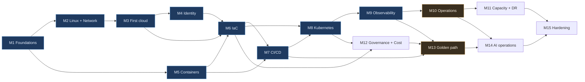

# Steps 13 & 14 — Timeline and Weekly Pattern

## 1. The budget

| | Hours |
|---|---|
| Weekdays, 5 × 1–1.5 h | 5–7.5 |
| Weekend, one longer session | 3–5 |
| **Per week** | **8–12.5, call it 10** |

Assume **46 productive weeks a year.** Six weeks will disappear to work crunches, travel, illness and life. A plan that assumes 52 is a plan that makes you feel like a failure in March. Those six weeks are budgeted below as slack, not as a surprise.

The full sequence is **54 build weeks**, plus revision. That is the 12-month version. The shorter versions are not the same plan compressed — they are the same plan with named things removed, and each one below says exactly what is removed and what you lose by removing it.

## 2. Dependencies

Amber nodes are the two milestones that differentiate you for *this* JD. **They are the last things to cut, not the first** — which is the opposite of most people's instinct, because they are the least glamorous.

Two useful properties of this graph: **M5 (Containers) only needs M1**, so it can be pulled forward into any week where cloud spend must pause; and **M12 (Governance) does not depend on M9–M11**, so it can be moved earlier if a cost problem makes it urgent.

## 3. The three versions

### 9-month, recommended — 39 weeks

The right trade-off. Everything the JD requires, at real depth, with the AI desirable present but not padded.

| Weeks | Milestone | Notes |
|:--:|---|---|
| 1–2 | M1 Foundations | |
| 3–5 | M2 Linux + networking | Do not trim this. It pays back in every later incident |
| 6–8 | M3 First cloud, by hand | Free trial credit |
| 9–10 | M4 Identity | |
| **11** | **Revision** | Consolidate. Book the Terraform exam |
| 12–13 | M5 Containers | |
| 14–17 | M6 IaC | Terraform Associate at the end |
| 18–20 | M7 CI/CD | |
| 21–24 | M8 Kubernetes | Compressed from 5 to 4: `kind` labs on weekdays, AKS on weekends |
| **25** | **Revision** | AZ-104 gap-check against the objective domain |
| 26–28 | M9 Observability | AZ-104 exam at the end |
| 29–31 | M10 Operations | 3 weeks, 8+ scenarios. **Do not cut below 3** |
| 32–33 | M11 Capacity + DR | Compressed: one full DR drill instead of two, capacity trimmed to two bottleneck iterations |
| 34–35 | M12 Governance + cost + Arc | |
| 36–38 | M13 Golden path | **Do not cut.** This is the differentiator |
| 39 | M14 AI operations, reduced | Flightdeck with five tools and a five-case eval set; the summariser service is dropped |
| — | M15 Hardening | Threat model and the leaked-credential drill only; folded into week 39's weekend |

**Dropped versus the 12-month version:** the second DR drill, two capacity iterations, the AI summariser service, WAF tuning, egress restriction, portability. **What you lose:** depth in continuity and some security polish. **What you keep:** every P0 requirement and both differentiators.

### 12-month, deeper mastery — 54 build weeks + 4 revision ≈ 13 months

Every milestone at full length, revision weeks at 11, 25, 38 and 50, and slack absorbed rather than fought. Certifications: Terraform Associate (after M6), AZ-104 (after M9), optionally ITIL 4 Foundation (after M10) and CKA (after M11).

Take this version if you are not under time pressure. The extra thirteen weeks buy: a second DR drill (where the runbook actually becomes good), three full bottleneck iterations, the complete AI layer including the fallback-bearing summariser, proper security hardening with WAF tuning and egress control, and Milestone 15's optional portability work. It also means CKA is realistic, which the 9-month version does not.

### 6-month, minimum viable — 26 weeks

Only if you are applying to this or similar roles **now**. It is honest but thin, and you should know exactly where the thinness is.

| Weeks | Milestone | Compression |
|:--:|---|---|
| 1 | M1 Foundations | 1 week. Write `cargo-api` in one weekend |
| 2–3 | M2 Linux + networking | Labs 1, 3, 5, 7 only — but **keep lab 5**, the four failure modes |
| 4–5 | M3 First cloud | One VM, one database, one DNS record. Skip the PowerShell repetition |
| 6–7 | M4 Identity | Keep OIDC federation and the broken-role-assignment drill; skip the custom role derivation |
| 8 | M5 Containers | |
| 9–11 | M6 IaC | Non-negotiable at 3 weeks. Everything downstream depends on it |
| 12–13 | M7 CI/CD | |
| 14–16 | M8 Kubernetes | The six failure states are mandatory; skip the cluster upgrade |
| 17–18 | M9 Observability | Two dashboards, one SLO, four alerts |
| 19–21 | M10 Operations | **Do not compress.** 8 scenarios minimum |
| 22 | M11 Continuity only | One DR drill; capacity is dropped entirely |
| 23 | M12 Governance + cost | Two policies, a budget, the cost anomaly. Arc dropped |
| 24–26 | M13 Golden path | **Do not compress.** The differentiator |

**Dropped entirely:** capacity management and load testing, hybrid/Arc, the whole AI layer, hardening, portability, all certifications.

**Be honest about the consequence.** You can credibly claim: cloud infrastructure, Terraform, containers, Kubernetes, CI/CD, observability, incident and problem management, governance, cost, and self-service onboarding. You cannot claim capacity management, and the JD's AI desirable is unevidenced. In an interview, say so plainly and say what you would do next — **"here is what I deliberately have not built yet, and why"** is a stronger answer than a vague claim, and an experienced interviewer will test the vague claim in four minutes.

## 4. The weekly pattern

| Day | Focus | Hours | The rule |
|---|---|:--:|---|
| **Mon** | Concepts | 1–1.5 | Read and take notes. **No terminal.** Write down three questions you cannot yet answer |
| **Tue** | Hands-on lab | 1–1.5 | The phase's small experiments, in a scratch environment. Throwaway work, on purpose |
| **Wed** | Project implementation | 1–1.5 | Build the real thing. Commit |
| **Thu** | Implementation + break it | 1–1.5 | Finish, then run one failure exercise. **Never skip the failure exercise** |
| **Fri** | Review and documentation | 1 | ADRs, runbooks, README, incident records. Answer Monday's three questions in writing |
| **Sat/Sun** | Milestone block | 3–5 | One long session. The work that needs uninterrupted time: `terraform apply`, a cluster build, a DR drill, a game day |

Why this shape:

- **Monday without a terminal** is deliberate. Understanding before typing is the whole thesis of the roadmap, and it is the difference between knowing why and knowing which button.
- **Friday is documentation** because documentation written on the day you did the work is honest, and documentation written a month later is fiction. The JD names "clear and concise technical documentation and operational procedures" as a requirement; this is the habit that produces it.
- **Failure exercises on Thursday** means you never reach the weekend with untested work, and it spreads breakage across the week rather than bunching it.
- **Azure spend lives mostly on the weekend.** `make up` Saturday morning, `make down` Sunday evening. Weekday work is local: `kind`, docker-compose, Terraform `plan` and `validate`.

### A weekend session template
1. `make up` (10 min) — and if it fails, that is today's first incident.
2. Re-read last week's Friday notes (10 min).
3. The milestone's main build work (2–3 h).
4. One failure exercise, timed, with the record written during (45 min).
5. Commit, update the README, `make down` (20 min).

## 5. Revision weeks

**Every sixth week, build nothing new.** Weeks 11, 25, 38 and 50 in the 12-month version; weeks 11 and 25 in the 9-month; week 13 in the 6-month.

A revision week is:
- **Reproduce from memory.** Pick three failure exercises from earlier milestones and run them again without notes. What you cannot reproduce, you did not learn — go back and do it properly.
- **Read your own documentation as a stranger.** Follow one runbook literally. Every stumble is a defect; fix it.
- **Update the README's numbers.** Rollback time, RTO/RPO, monthly cost, request ceiling, onboarding time. If a number is stale, it was never real.
- **Answer the interview questions** from the relevant milestones' "Evidence of mastery" sections out loud. Hedging means not finished.
- **Take an exam**, if one is due.
- **Rest.** Sustainable pace beats heroics over a year, and burning out in month four is the most common way this roadmap fails.

## 6. What to do when you fall behind

You will. The options, in order of preference:

1. **Cut scope inside the milestone**, keeping the failure exercises and the deliverable. Three dashboards instead of four is fine; skipping the incident record is not.
2. **Cut an entire milestone** using the dependency graph — M12 and M14 are the safest removals, M11's capacity half next.
3. **Extend the timeline.** Better than skipping the operations or golden-path work.
4. **Never cut M10 or M13.** They are the two things that make you different from every other candidate, and they are the two you will be most tempted to cut because neither produces an impressive screenshot.

→ Next: [Step 15 — Progress measurement](14-progress-measurement.md)
