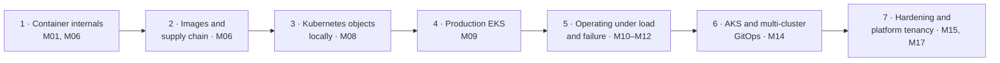

# Section 14 — Docker & Kubernetes Learning Path

This track runs from *what a container actually is* to *operating two production clusters in two clouds through GitOps*. Kubernetes is where most self-taught engineers stop at the basics: they can write a Deployment and have never diagnosed a node that ran out of IP addresses, upgraded a cluster with traffic on it, or explained why a CPU limit made a service slower. This track does not stop there.

> JD evidence: *"Understanding of containerisation and orchestration technologies such as **Docker, Kubernetes, Amazon EKS, Azure AKS**"* · *"cloud-native platforms"* · *"Manage end-of-life replacement of equipment and/or software"* (cluster versions, add-ons, ingress controllers) · *"Troubleshooting across application and cloud infrastructure layers"*.

---

## 1. The progression

| Stage | Milestones | ≈ Months | Level at exit |
|---|---|:--:|:--:|
| 1 — Container internals | [M01](milestones/M01-linux-networking.md), [M06](milestones/M06-containers.md) | 2, 6 | L3 |
| 2 — Images and supply chain | [M06](milestones/M06-containers.md), [M07](milestones/M07-cicd.md) | 6–8 | L3 |
| 3 — Kubernetes objects (local, free) | [M08](milestones/M08-kubernetes-fundamentals.md) | 8–9 | L3 |
| 4 — Production EKS | [M09](milestones/M09-eks.md) | 9–10 | L3→L4 |
| 5 — Operating under load and failure | [M10](milestones/M10-observability.md)–[M12](milestones/M12-capacity-ha-dr.md) | 11–14 | L4 |
| 6 — AKS and multi-cluster GitOps | [M14](milestones/M14-aks-multicluster.md) | 15–16 | L4 |
| 7 — Hardening and platform tenancy | [M15](milestones/M15-security-governance.md), [M17](milestones/M17-golden-paths.md) | 17–19 | L4→L5 |

**Economics:** learn objects on `kind`/`k3d` for free; spend cloud money only on what a real cluster teaches — node provisioning, cloud load balancers, cloud identity, upgrades, IP management, zone failure.

---

## 2. Stage 1 — Container internals

A container is **a process** with a restricted view (namespaces: pid, net, mnt, uts, ipc, user, cgroup), restricted resources (**cgroups** v2), and a layered filesystem (overlayfs) — not a lightweight VM. In [M01](milestones/M01-linux-networking.md) you meet these as Linux features; in [M06](milestones/M06-containers.md) you recognise them inside Docker.

Must-know mechanics: PID 1 and signal handling (why a shell-form `CMD` ignores `SIGTERM` and gets `SIGKILL`ed after the grace period); exit codes (137 = SIGKILL, often OOM; 143 = SIGTERM; 1 = app error); the OOM killer and cgroup memory limits; container networking (veth pairs, bridges, NAT) — the same model the CNI extends.

**Lab that proves it:** run a container, find its process on the host, enter its namespaces with `nsenter`, read its cgroup memory limit from `/sys/fs/cgroup`, and OOM it on purpose (S09).

## 3. Stage 2 — Images and the supply chain

| Concept | Why it matters in production |
|---|---|
| Layers and cache ordering | Build time is deployment latency; dependency layer before code layer |
| Multi-stage builds | No compilers or build tools in the runtime image |
| Base image choice (distroless / slim / alpine and the musl trap for Python wheels) | CVE count, size, debuggability trade-off (ADR-006) |
| Non-root, read-only root filesystem, dropped capabilities | The hardening regression S08 is the most common "works in dev" failure |
| Tags vs **digests** | Deploy digests; tags move |
| Scanning (**Trivy**), **SBOM** (**Syft**), signing (**cosign**) | Signed at build, **verified at admission** by Kyverno in Stage 7 |
| Registry policy | ECR immutable tags, scan on push, lifecycle rules; cross-account pull |

Deliverables: hardened Dockerfiles for every workload, images in ECR by digest, a triaged scan report, ADR-006.

## 4. Stage 3 — Kubernetes objects (local)

The one idea that makes Kubernetes predictable: **the reconciliation loop** — you declare desired state in the API server, controllers continuously converge reality toward it. Everything else is a specific controller.

| Object family | What to understand deeply |
|---|---|
| Control plane | API server (the only thing that talks to etcd), scheduler, controller manager; kubelet and kube-proxy on nodes; what happens between `kubectl apply` and a running pod, step by step |
| **Pods** | Shared network namespace; init and sidecar containers; restart policy |
| **Deployments** / ReplicaSets | Rolling update, `maxSurge`/`maxUnavailable`, revision history, **rollback** (`rollout undo`) |
| StatefulSets, DaemonSets, Jobs, CronJobs | When each is correct; Redis as a StatefulSet in Runway |
| **Services** | ClusterIP, NodePort, LoadBalancer; endpoints/EndpointSlices; readiness removes a pod from endpoints |
| **Ingress** → **Gateway API** | Ingress is the old API; Gateway API (GatewayClass, Gateway, HTTPRoute) is the current one. **ingress-nginx was retired (announced Nov 2025, maintenance ended Mar 2026)** — you use it once locally, then replace it: your first EOL replacement (ADR-009) |
| **ConfigMaps / Secrets** | A Secret is base64, not encryption; etcd encryption and external secret stores |
| **PersistentVolumes** | PV, PVC, StorageClass, access modes, volume binding mode (`WaitForFirstConsumer` and zones) |
| **Requests and limits** | Requests drive scheduling; limits drive throttling (CPU) and OOM kills (memory); QoS classes |
| **Probes** | Liveness (restart me), readiness (don't send me traffic), startup (I'm slow to boot) — and the self-inflicted outage of a liveness probe on a slow dependency |
| **Namespaces**, ResourceQuota, LimitRange | Tenancy primitives the golden path later automates |
| **RBAC** | Role/ClusterRole, bindings, service accounts; least privilege for humans and controllers |
| **NetworkPolicy** | Default-deny, then explicit allows; requires a CNI that enforces it |
| **Helm** | Templating and releases for third-party charts; Kustomize or thin templating for your own |

**The six pod failure states** — deliberately cause and diagnose each on `kind` (S12, extended in S13):

| State | Typical cause | The three commands that identify it |
|---|---|---|
| `ImagePullBackOff` / `ErrImagePull` | Wrong tag/digest, registry auth, no egress to registry | `kubectl describe pod` (Events) · `kubectl get events --sort-by=.lastTimestamp` · check the image reference and pull credentials |
| `CrashLoopBackOff` | App exits on start: bad config, missing dependency, bad command | `kubectl logs <pod> --previous` · `kubectl describe pod` (Last State, exit code) · `kubectl get pod -o yaml` (command/args/env) |
| `OOMKilled` | Working set above the memory limit | `kubectl describe pod` (Reason: OOMKilled, exit 137) · `kubectl top pod` · compare limits with actual usage in metrics |
| `Pending` | No node fits: resources, taints, affinity, PVC zone, quota, **IP exhaustion on EKS** | `kubectl describe pod` (FailedScheduling message) · `kubectl describe node` (Allocatable/Allocated) · autoscaler/Karpenter logs |
| `CreateContainerConfigError` | Missing ConfigMap/Secret or key | `kubectl describe pod` · `kubectl get cm,secret -n <ns>` · check ExternalSecret status |
| Running but never Ready | Readiness probe failing: wrong port/path, dependency down, slow start | `kubectl describe pod` (probe failures) · `kubectl get endpointslices` · `kubectl exec` / `port-forward` and call the endpoint yourself |

Completion bar: **any of the six diagnosed in under five minutes from `kubectl` alone**, cause explained.

## 5. Stage 4 — Production EKS

Built in [M09](milestones/M09-eks.md). The topics a local cluster cannot teach:

| Topic | What you build and learn | ADR / scenario |
|---|---|---|
| Cluster in Terraform | Private + public endpoint decision, access entries, managed add-ons (VPC CNI, CoreDNS, kube-proxy, Pod Identity agent) | ADR-005 |
| **Node pools and autoscaling** | A small managed node group for system components; **Karpenter** NodePools (on-demand for stateful/system, spot for stateless) with consolidation and disruption budgets | ADR-010 · S13 |
| **VPC CNI** | IPs per ENI, prefix delegation, subnet sizing — the IP-exhaustion Pending | S13 |
| **Workload identity** | EKS Pod Identity (used), IRSA (understood) | S14 |
| **Traffic entry** | AWS Load Balancer Controller → ALB with ACM, Gateway API routes | ADR-009 |
| Secrets | External Secrets Operator → Secrets Manager | ADR-011 |
| **HPA** | CPU and custom metrics (requests/second); stabilisation windows; min/max as capacity and cost decisions | S19 later |
| **Cluster autoscaling** | Karpenter reacting to Pending pods; interaction with wrong requests (over-request = cost, under-request = noisy neighbours) | S13 |
| **Scheduling** | Topology spread across 3 AZs, affinity/anti-affinity, taints/tolerations for the `platform` pool, priority classes | S21 later |
| **PDBs** | Voluntary disruptions (drains, consolidation, upgrades) vs involuntary (node loss) | S21 |
| **Rolling deployments and rollback** | `maxUnavailable: 0`, rollout status as a pipeline gate, timed `rollout undo` | S10 |
| **Upgrades** | Control plane → add-ons → nodes; version skew policy; deprecated API detection before upgrading (e.g. `kubent`/pluto); extended support cost as an EOL driver | S36 |
| Migration | ECS → EKS with zero downtime via weighted target groups (a real change, with a PIR) | ADR-008 |

## 6. Stage 5 — Operating under load and failure

[M10](milestones/M10-observability.md)–[M12](milestones/M12-capacity-ha-dr.md): **monitoring** (kube-state-metrics, node exporter, cAdvisor → AMP; RED dashboards per service; USE per node), **logging** (OTel Collector → Loki, structured JSON with trace IDs), **troubleshooting** under load: CPU throttling (S19), connection exhaustion (S18), node loss and spot interruption (S21), AZ failure reasoning, restoring a StatefulSet's data. Capacity: HPA tuned from k6 results, Karpenter limits as a cost ceiling.

## 7. Stage 6 — AKS and multi-cluster

[M14](milestones/M14-aks-multicluster.md) teaches the *differences* (see [Section 12](12-azure-learning-path.md)): Azure CNI Overlay vs VPC CNI, system/user pools, node auto-provisioning, AKS Workload Identity, Entra-integrated `kubectl`, auto-upgrade channels and maintenance windows, Envoy Gateway + cert-manager instead of a cloud-native controller.

The genuinely new problem is **two clusters in two clouds**. Push-based pipelines holding credentials to both become the risk; **Argo CD** (ADR-018) brings the pull model, continuous drift reconciliation, app-of-apps for add-ons, ApplicationSets to stamp the same workload onto `aws` or `azure` targets from `workload.yaml`. S26 (OutOfSync after a manual change or a bad sync wave) is its signature failure.

## 8. Stage 7 — Hardening and platform tenancy

[M15](milestones/M15-security-governance.md): **Pod Security Standards** (`restricted` for workloads), `securityContext` defaults (non-root, read-only root FS, drop ALL capabilities, seccomp `RuntimeDefault`), **Kyverno** policies (verify cosign signatures, disallow `:latest`, require requests/limits and labels), default-deny NetworkPolicy with explicit allows including egress, audit logging, least-privilege RBAC for humans and for Argo CD.
[M17](milestones/M17-golden-paths.md): namespace-as-a-service — the `workload` module and GitOps templates create namespace, quota, LimitRange, NetworkPolicy baseline, service account + cloud identity, dashboards and alerts from one `workload.yaml`.

---

## 9. Failure scenario table

| # | Symptom | Injected cause | Layer | Stage | Scenario |
|:--:|---|---|---|:--:|:--:|
| 1 | Container restarts, exit 137 | Memory limit below working set | Container / cgroup | 1–3 | S09 |
| 2 | New image crashes only in prod | Non-root user writing to a read-only path | Image | 2 | S08 |
| 3 | Pods never Ready | Each of the six failure states | Pod | 3 | S12 |
| 4 | Healthy-but-slow pods restart in a loop | Liveness probe depends on a slow dependency | Probe design | 3 | S12 |
| 5 | Pipeline green, users get 5xx | Rollout not gated on readiness | Delivery | 4 | S10 |
| 6 | Pods Pending on EKS with free CPU | Subnet out of IPs (VPC CNI) | Network / scheduling | 4 | S13 |
| 7 | Pods Pending, Karpenter idle | NodePool requirements unsatisfiable / quota / subnet tags | Autoscaling | 4 | S13 |
| 8 | Pod gets AccessDenied from AWS | Pod Identity association on wrong service account | Identity | 4 | S14 |
| 9 | Nodes cannot pull images | NAT route / ECR endpoint missing | Egress | 4 | S15 |
| 10 | 502 from ALB while pods Running | Target health vs readiness mismatch, wrong target port | Traffic entry | 4 | — |
| 11 | Latency high, CPU graph fine | CPU throttling from low limits | Resources | 5 | S19 |
| 12 | Brief outage on node drain | No PDB, replicas on one node | Availability | 5 | S21 |
| 13 | Spot interruption takes out a stateful pod | Wrong pool placement | Scheduling | 5 | S21 |
| 14 | Upgrade blocked / workloads break after upgrade | Removed APIs, EOL add-on | Lifecycle | 4, 6 | S36 |
| 15 | Prod differs from Git | Manual `kubectl edit`; Argo CD self-heal off | GitOps | 6 | S26 |
| 16 | AKS pod cannot reach Key Vault | Private DNS zone link missing | Network / DNS | 6 | S24 |
| 17 | Unsigned image deployed / blocked | Kyverno verify-images policy | Admission | 7 | — |
| 18 | Service unreachable after default-deny | Missing egress allow for DNS | NetworkPolicy | 3, 7 | — |

Each major scenario is written up as **Detection → Investigation → Mitigation → Root Cause → Permanent Fix → Prevention** — see [Section 10](10-failure-and-troubleshooting.md).

---

## 10. Checkpoints

| After | Checkpoint (without notes) |
|---|---|
| Stage 1–2 | Explain what happens between `docker run` and your process executing; state your image's size, user, CVE count and what you did about it. |
| Stage 3 | Walk through `kubectl apply` → running pod; diagnose the six states in under five minutes each. |
| Stage 4 | Upgrade EKS one minor version with k6 traffic flowing and zero failed requests above your SLO; explain VPC CNI IP maths for your node types. |
| Stage 5 | Explain why CPU limits can make a service slower, with your own graph. |
| Stage 6 | Break prod by hand, watch Argo CD revert it, and explain when self-heal should be off. |
| Stage 7 | Show an unsigned image being rejected at admission and a pod running under `restricted` Pod Security. |

**CKA** fits at R4 (~month 14), after Stage 5 — see [Section 21](21-certification-strategy.md).

---

## 11. Resources

1. **Kubernetes documentation** — Concepts: "Workloads", "Services, Load Balancing, and Networking", "Scheduling, Preemption and Eviction", "Configuration → Resource Management for Pods"; Tasks: "Monitoring, Logging, and Debugging → Debug Pods / Debug Services"; "Version Skew Policy"; Gateway API docs.
2. ***Kubernetes Up & Running*, 3rd ed** — ch. 5–10 for objects in Stage 3; ***Production Kubernetes* (Rosso et al.)** — ch. on multitenancy, autoscaling, admission control, platform abstractions for Stages 4–7.
3. **EKS Best Practices** (EKS docs) — Networking, Security, Cluster Autoscaling/Karpenter, Upgrades; **AKS baseline architecture** (Azure Architecture Center) for Stage 6.
4. ***Docker Deep Dive* (Poulton)** — images and containers chapters; **iximiuz Labs** container-internals and networking tutorials for Stage 1.
5. **Kubernetes the Hard Way (Hightower)** — once, around M08/M09, to see every component you normally never touch; **killer.sh** before CKA.

→ Next: [Section 15 — CI/CD Learning Path](15-cicd-learning-path.md)
