# Section 15 — CI/CD Learning Path

*The spine of release engineering across the whole roadmap: from "tests run on a PR" to multi-cluster GitOps with change records, measured rollback and DORA metrics. The detail lives in the milestones; this document shows how the discipline grows and where each stage is built.*

---

## 1. What the JD actually asks for

> *"Strong experience with DevOps practices, including: Git · CI/CD pipelines · Automated testing · Automated deployment"*
> *"...drive the adoption of Infrastructure as Code, CI/CD, observability, governance, and FinOps practices"*
> *"...onboarding applications using governed and automated DevOps practices."*
> *"Own and manage changes within the technology area."*

Read those four lines together. **"Governed and automated"** is the key phrase. The employer does not want a fast pipeline; it wants a pipeline that can run at enterprise scale *and* satisfy change management, security and audit. A senior engineer here does not build a pipeline — they build the pipeline *other teams* use, and they can show the change record every deployment produced.

**Depth expected:** Production Proficiency on pipelines and automated testing; Advanced on release strategy, change management integration and multi-environment/multi-cluster delivery.

## 2. The five ideas the whole track rests on

| Idea | Why it matters | Where it first bites |
|---|---|---|
| **Build once, promote by digest** | The artefact tested in dev must be bit-identical to the one in prod. Rebuilding per environment means your tests certified a different thing | [M07](milestones/M07-cicd.md) |
| **No long-lived credentials in CI** | The pipeline identity is the most privileged, least watched identity in most organisations. OIDC federation removes the secret entirely | [M04](milestones/M04-aws-core.md), [M07](milestones/M07-cicd.md), [M13](milestones/M13-azure-core.md) |
| **Rollback is a capability, measured in seconds** | "We can roll back" is a belief until you have timed it | [M07](milestones/M07-cicd.md), [M11](milestones/M11-sre-operations.md) |
| **The pipeline must not lie** | A green deploy with a dead service is worse than a red one — it removes the signal | [M07](milestones/M07-cicd.md) (S10) |
| **Pipelines are a product** | Reusable workflows let you change every team's delivery at once; copy-paste pipelines let you change nothing | [M07](milestones/M07-cicd.md) → [M17](milestones/M17-golden-paths.md) |

## 3. The progression

```mermaid
flowchart LR
    S1["Stage 1<br/>PR checks<br/>M00"] --> S2["Stage 2<br/>Build · scan · push<br/>M06"]
    S2 --> S3["Stage 3<br/>Deploy + promote + rollback<br/>ECS Fargate · M07"]
    S3 --> S4["Stage 4<br/>Infra pipelines<br/>M05→M07"]
    S4 --> S5["Stage 5<br/>Kubernetes delivery<br/>M09"]
    S5 --> S6["Stage 6<br/>Change mgmt + DORA<br/>M11"]
    S6 --> S7["Stage 7<br/>GitOps multi-cluster<br/>Argo CD · M14"]
    S7 --> S8["Stage 8<br/>Supply-chain gates<br/>M15"]
    S8 --> S9["Stage 9<br/>Pipelines as platform<br/>M17–M18"]
    S9 --> S10["Stage 10<br/>CI/CD for AI<br/>M19–M20"]
```

### Stage 1 — PR checks and branch protection · [M00](milestones/M00-foundations.md)
**Concepts:** trunk-based development; why long-lived branches create integration pain; protected branches, required checks, CODEOWNERS; semantic versioning; conventional commits (optional, but they make changelogs free).
**You build:** a workflow running lint, type check and unit tests on every PR to `cargo-api`; branch protection with no direct push to `main`.
**Checkpoint:** you cannot merge a failing PR, and you can explain why you would not want to.

### Stage 2 — Build, scan, sign, push · [M06](milestones/M06-containers.md)
**Concepts:** image digests vs tags; layer caching in CI; SBOM generation; vulnerability scanning thresholds and triage policy; why the scan runs *before* the push.
**You build:** the first version of the `build-sign-push` reusable workflow: build multi-stage image → Trivy scan → Syft SBOM → push to ECR by digest. (Cosign signing is added here and *enforced* at admission in Stage 8.)
**Checkpoint:** you can state which digest is running and which commit produced it.

### Stage 3 — Deploy, promote, roll back · [M07](milestones/M07-cicd.md)
**Concepts:** environments and protection rules; approvals; the **automated testing pyramid** (below); deployment strategies — recreate, rolling, blue-green, canary — and their cost/risk trade-offs; **expand–contract** migrations; smoke tests as a deployment gate; OIDC from GitHub Actions to an AWS IAM role with a tight `sub` condition.
**You build:** `deploy` reusable workflow targeting **ECS Fargate** (ADR-007): dev on merge, prod on approval, same digest, smoke test, automatic rollback on failed health. Measured rollback time in the README.
**Checkpoint:** a broken release rolled back in a measured number of seconds; a migration shipped with expand–contract without downtime.

### Stage 4 — Infrastructure through the pipeline · [M05](milestones/M05-terraform.md) → [M07](milestones/M07-cicd.md)
**Concepts:** plan on PR, apply on merge; plan as a reviewable artefact (saved plan file applied exactly); Terraform quality gates (fmt, validate, tflint, `terraform test`, trivy/checkov, conftest on plan JSON, Infracost comment); nightly drift detection; nobody runs `apply` from a laptop.
**You build:** `tf-plan-apply` and `drift-detect` reusable workflows; per-root concurrency so two applies never race on one state.
**Checkpoint:** a PR that would destroy the database is stopped by a gate, not by your eyes.

### Stage 5 — Delivery to Kubernetes · [M09](milestones/M09-eks.md)
**Concepts:** rollout status as the real success signal; `maxSurge`/`maxUnavailable`; readiness gates with the ALB; Helm for third-party charts vs thin Kustomize overlays for your own; manifest validation (kubeconform) and policy tests in CI; zero-downtime migration from ECS to EKS using weighted target groups (ADR-008).
**You build:** `deploy` now supports EKS and fails the job if the rollout does not converge.
**Checkpoint:** the ECS→EKS cut-over done with traffic flowing and a written change record.

### Stage 6 — Change management and DORA · [M11](milestones/M11-sre-operations.md)
**Concepts:** the JD's *"Own and manage changes"* in engineering terms (§5 below); change types — standard, normal, emergency; risk scoring; freeze windows; post-implementation review (PIR) for failed changes; the **four DORA metrics** (deployment frequency, lead time for changes, change failure rate, time to restore) plus rework rate; why small, frequent, reversible changes *are* the risk control.
**You build:** `change-record` reusable workflow — every production deploy and apply writes `docs/changes/CHG-NNN.md` (or a labelled issue) with what, why, risk, rollback plan, evidence links and outcome; a monthly DORA summary in the operational review.
**Checkpoint:** S35 — a release that caused an outage, handled as an emergency change with a PIR.

### Stage 7 — GitOps across two clouds · [M14](milestones/M14-aks-multicluster.md)
**Concepts:** push vs pull delivery; reconciliation as continuous drift correction; Argo CD applications, projects, app-of-apps, ApplicationSets, sync waves and hooks, health assessment; why CI should no longer hold cluster credentials once there are two clusters in two clouds (ADR-018); how GitOps and change records coexist (the merge *is* the change; the sync is the implementation).
**You build:** Argo CD managing cluster add-ons and workloads on EKS and AKS; CI now only builds, signs and updates a Git reference; environment promotion is a PR.
**Checkpoint:** S26 — prod differs from Git; you find out why, and decide whether Git or the cluster was right.

### Stage 8 — Supply-chain and policy gates · [M15](milestones/M15-security-governance.md)
**Concepts:** SLSA levels at a conceptual level; provenance attestations; signature verification at admission (Kyverno); policy-as-code in the pipeline as enforcement point #1 of four; dependency pinning and update automation (Renovate/Dependabot) with a triage SLA.
**You build:** unsigned or unscanned images cannot run in either cluster; a policy violation fails the PR, not the deploy.

### Stage 9 — Pipelines as a platform product · [M17](milestones/M17-golden-paths.md), [M18](milestones/M18-developer-platform.md)
**Concepts:** reusable workflows versioned and released like modules; thin caller workflows (6–15 lines); the test *"can I add a mandatory stage without a PR in any workload repo?"*; optional progressive delivery with Argo Rollouts (canary with automated analysis against SLO metrics).
**You build:** the golden-path template's CI is a single call to your workflows; `hello-svc` deploys to AWS *and* Azure through the same pipeline contract.

### Stage 10 — CI/CD for AI workloads · [M19](milestones/M19-ai-infrastructure.md), [M20](milestones/M20-ai-agents-mcp.md)
**Concepts:** prompts and model versions as deployable configuration; eval sets as regression gates; non-deterministic tests (thresholds, not exact matches); cost as a test assertion (tokens per case); the "no write-capable tool registered" test for flightdeck.
**You build:** eval gate in the `ai-gateway`/`insights-worker` pipelines; prompt changes roll back exactly like code.

## 4. The automated testing pyramid you will actually run

| Layer | What | Tool | Runs | Milestone |
|---|---|---|---|---|
| Static | lint, types, formatting, secret scan | ruff, mypy, eslint/tsc, gitleaks | every push | M00 |
| Unit | pure logic | pytest, vitest | every push | M00 |
| Contract | API matches the OpenAPI contract; consumers not broken | schemathesis / openapi diff | PR | M07 |
| Integration | real Postgres/Redis/SQS in containers | testcontainers, LocalStack (sparingly) | PR | M07 |
| Infrastructure | module behaviour and policy | `terraform test`, conftest, tflint, trivy config | PR | M05 |
| Manifests | schema + policy | kubeconform, Kyverno CLI | PR | M09, M15 |
| Smoke | the deployed thing answers correctly | curl/pytest against the environment | after each deploy | M07 |
| Performance | latency/throughput regression against a baseline | k6 with thresholds | nightly / pre-prod | M12 |
| AI eval | quality and cost per case within thresholds | custom harness | PR on prompt/model change | M19 |

The rule: **fast and cheap at the bottom, slow and expensive at the top, and every layer must be able to fail the pipeline.** A test that has never failed a build has not yet proven it tests anything.

## 5. Change management, the engineering version

Enterprises like the target employer run formal change management. The senior move is not to fight it but to **automate the evidence** so that low-risk changes become standard changes.

| Change type | Definition in Runway | Approval | Evidence produced automatically |
|---|---|---|---|
| **Standard** | Pre-approved, repeatable, low-risk: a workload deploy through the golden path that passed all gates | None beyond PR review | Change record, digest, test results, rollout status |
| **Normal** | Anything touching shared platform: cluster upgrade, network change, policy change, module major version | Recorded approval (GitHub environment reviewer) + risk score + rollback plan | Same + plan output + scheduled window |
| **Emergency** | Restore service during an incident | Retrospective approval within 24 h | Linked to the INC record; PIR mandatory |

A change record is complete only when its **outcome** is recorded (successful / rolled back / caused incident). That field is what makes change failure rate computable.

## 6. Checkpoints across the track

| By | You can |
|---|---|
| M07 | State the digest in prod, the commit that produced it, and your measured rollback time |
| M09 | Migrate a live service between runtimes without an error-rate blip, with a change record |
| M11 | Show four DORA metrics from your own records and explain what moved them |
| M14 | Explain why GitOps is justified *now* and was not in M07 |
| M17 | Add a mandatory pipeline stage for every consumer with one PR to one repo |
| M19 | Show a prompt change blocked by an eval gate |

## 7. Failure scenarios owned by this track
S04 (AccessDenied in the pipeline), S10 (green pipeline, dead service), S11 (incompatible migration), S26 (GitOps drift), S28 (policy deny blocks all deploys), S35 (failed change → emergency change + PIR). Full injection and diagnosis detail: [Section 10](10-failure-and-troubleshooting.md).

## 8. Resources

1. **GitHub Actions docs** — "Reusing workflows", "Security hardening for GitHub Actions" and "About security hardening with OpenID Connect" (then the AWS and Azure OIDC guides). Read the hardening page twice.
2. ***Continuous Delivery* (Humble & Farley)** — ch. 5 "Anatomy of the Deployment Pipeline" and ch. 10 "Deploying and Releasing Applications". Old, and still the clearest statement of build-once-promote.
3. ***Accelerate* (Forsgren, Humble, Kim)** — ch. 2 "Measuring Performance" and Part I's capabilities list. Read before M11 so DORA metrics mean something.
4. **Argo CD docs** — "Core Concepts", "Sync Waves and Hooks", "ApplicationSet" and "Cluster Management". Before M14.
5. **Terraform docs** — "Tests" (`terraform test`) and HashiCorp's "Automate Terraform with GitHub Actions" tutorial. Before M05's pipeline work.

→ Next: [Section 16 — Observability & SRE Learning Path](16-observability-sre-learning-path.md)
