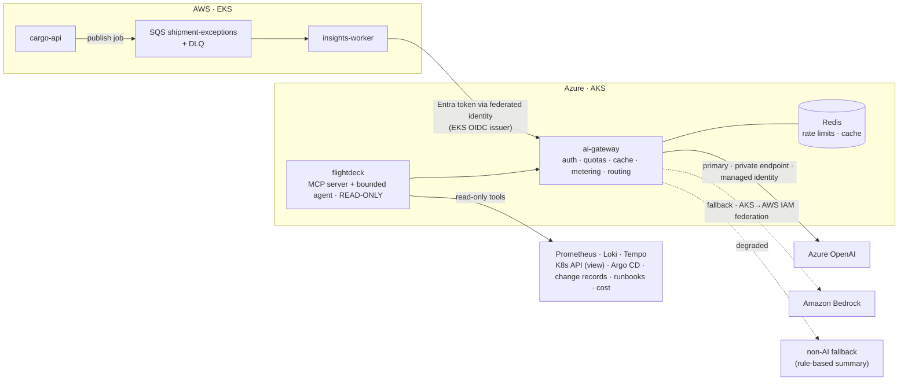

# Section 20 — AI Infrastructure Learning Path

*How to operate AI workloads — not how to build models. AI arrives at month ~21, on top of a platform you already run, and it is treated as what it is operationally: a slow, expensive, quota-limited, non-deterministic dependency that needs the same rigour as everything else, plus a few new failure modes.*

---

## 1. What the JD actually asks for

> *"Experience with the following would be advantageous: AI / Generative AI (GenAI) · AI agents · Model Context Protocol (MCP) integrations"*

**Advantageous.** Not required. And the listed items are *integration* items: GenAI services, agents, MCP. That shapes everything in this track:

- It is **last** (M19–M20), after the platform, operations, security and FinOps foundations are solid. You can only operate what you already know how to run.
- It occupies **~7 of 84 build weeks** — enough to be genuinely credible, not enough to reposition you as an AI engineer.
- The deliverables are **platform components** (a shared AI gateway, an async AI workload, a read-only operations agent) — exactly what a Platform Engineering team would own.

**Depth expected by the JD:** Working Knowledge. **Depth this roadmap targets:** Production Proficiency on operating AI workloads (it is your stated career direction), Working Knowledge on agents and MCP design, Foundation on self-hosted inference and GPUs.

## 2. Why AI comes this late — and why that is the engineering argument

By M19 you will have run ~30 incidents by hand, designed SLOs, built a golden path, and investigated cost anomalies. That is precisely what operating AI requires: the new skills are thin; the transferred skills are thick. Built at M02, the same components would be demos with no baseline to measure against. Say this in interviews — the sequencing *is* the judgement.

## 3. The AI architecture in Runway

| Component | Problem it solves | Milestone |
|---|---|---|
| **ai-gateway** | Every team calling models directly means N sets of keys, no quotas, no cost attribution, no fallback, no audit. A shared gateway is the platform pattern (ADR-023) | [M19](milestones/M19-ai-infrastructure.md) |
| **insights-worker** + SQS | LLM latency is variable and quota-limited; synchronous calls from `cargo-api` would couple its SLO to a model's. The queue absorbs bursts and gives backpressure | M19 |
| **Model routing** Azure OpenAI → Bedrock → non-AI | A single provider/region quota is a single point of failure; the non-AI fallback turns "AI down" from an incident into a degradation | M19 |
| **Self-hosted model lab** | You cannot argue managed vs self-hosted without having measured both (ADR-024) | M19 (timeboxed) |
| **flightdeck** | Compresses time-to-first-hypothesis for a human during incidents, using the queries you already run by hand (ADR-025) | [M20](milestones/M20-ai-agents-mcp.md) |

## 4. The progression

### Stage 1 — Running an AI dependency like any other (M19, weeks 1–2)
- **AI service architecture:** model APIs, deployments/model versions, regions, the quota model (tokens per minute / requests per minute), content filtering, and what "managed" does and does not cover.
- **Managed AI on both clouds:** Azure OpenAI / Azure AI Foundry (deployments, quotas, private endpoint, Entra auth) and Amazon Bedrock (model access, on-demand vs provisioned throughput, IAM). Learn the *concepts* once, map them twice.
- **Identity and secrets:** managed identity to Azure OpenAI, cross-cloud federation to Bedrock — **no API keys anywhere**. Where a vendor forces a key, it lives in Key Vault/Secrets Manager via External Secrets and is rotated.
- **Network:** private endpoint + private DNS for Azure OpenAI; verify the public endpoint is unreachable from the cluster (reuse S24 skills).
- **Latency:** time-to-first-token vs total completion time; streaming changes UX, not cost; model latency variance is far larger than a database's, so percentile discipline matters more.
- **Rate limiting and retries:** `429` is normal feedback, not an outage. Exponential backoff with full jitter; honour `retry-after`; per-team quotas in the gateway so one team cannot starve the rest; **naive retries turn a brief limit into a sustained self-inflicted outage** (S31).
- **Timeouts, circuit breakers, fallbacks:** exactly as you treated `carrier-sim` in M10–M11.
- **Structured outputs and validation:** schema-constrained output validated before use; one repair attempt, then fail closed to the fallback. Two reasons, both needed in interview: correctness, and security (model output is untrusted input).
- **Caching:** exact-match response cache in Redis keyed on normalised prompt + model + prompt version; hit rate as a cost and latency metric. Semantic caching discussed, deliberately not built (correctness risk).
- **Queues and async:** SQS with visibility timeouts sized to model latency, DLQ with a runbook, idempotent consumers, poison-message handling, queue depth as the autoscaling signal (KEDA or HPA on external metric).

### Stage 2 — Scaling, cost, governance, delivery (M19, weeks 3–4)
- **Scaling:** the gateway scales on CPU/concurrency; the *real* ceiling is provider quota — capacity planning means quota planning (and quota increase lead times). Worker concurrency sized so that `concurrency × tokens/request ≤ TPM`.
- **Cost:** tokens in/out per request, attributed per team/service via the gateway; per-team token budgets; cost-rate alerts; cost per summary on the dashboard ([Section 19](19-finops-learning-path.md)).
- **Observability:** tokens, cost, TTFT, total latency, error rate by provider, 429 rate, validation-failure rate, fallback rate, cache hit rate — all broken down by prompt version and model version. GenAI semantic conventions in OTel for span attributes. **Never log full prompts containing sensitive data**; redact at the gateway.
- **Governance:** an approved-use register entry per consumer; data classification decides what may be sent (the data catalogue already knows); content filtering policy; retention of prompts/completions; model version pinning and a plan for model retirement (it *will* be retired — add it to the EOL register).
- **CI/CD for AI:** prompts and routing config in Git, deployed and rolled back like code; a 10–20 case **eval set** as a pipeline gate with quality *and* cost thresholds; canary a new model version on a percentage of gateway traffic.
- **Containerised inference (timeboxed lab):** run a small open-weights model on CPU (llama.cpp/Ollama or vLLM-CPU) in the cluster; measure latency, throughput, memory, node cost and cold start against the managed endpoint; write ADR-024. **GPU node pools** at concept level — drivers/device plugin, taints, bin-packing, scarcity and quota — plus an optional one-day spot GPU lab. No training, no fine-tuning.

### Stage 3 — Agents and MCP for operations (M20)
- **Tool calling:** the model *requests*; your code decides whether to comply. Every safety property lives on your side of that boundary.
- **MCP:** servers, clients, tools, resources, transports; remote MCP over Streamable HTTP authenticated with Entra ID. One server serves your agent, your IDE and a colleague's client.
- **Tool design:** descriptions are prompts; typed, validated arguments; errors written for a model ("service 'cargo' not found; valid: cargo-api, carrier-sim, ..."); bounded, truncated results.
- **Bounding the loop:** max steps, wall-clock timeout, token budget per session, per-tool rate limits.
- **Read-only by construction** — three independent mechanisms: (1) **identity** (AWS/Azure Reader-equivalent, Kubernetes `view`, read-only Argo CD role); (2) **surface** (no write tool registered; a CI test enumerates the registry and fails the build otherwise); (3) **audit** (every call logged with arguments, result size, identity, latency).
- **Prompt injection through tool results** (S33): logs are attacker-influenced; delimit and label tool output; the agent's output is advisory text for a human, never an input to automation; test it with a planted log line.
- **Evaluation:** replay ten of your own recorded incidents; score whether the correct hypothesis appears with real evidence; measure time-to-first-hypothesis before and after; publish the cases where it was confidently wrong.

## 5. How DevOps/SRE practice changes for AI workloads

| Practice | Traditional service | AI workload | What you change in Runway |
|---|---|---|---|
| Testing | Deterministic assertions | Non-deterministic outputs | Eval sets with thresholds; score distributions, not exact matches |
| Release | Code and config versions | + prompt version + model version + provider | All three tagged on every span; rollback covers prompts and routing |
| Capacity | CPU/memory/connections | **Provider quota (TPM/RPM)** is the ceiling | Quota forecasting; per-team quotas; queue smoothing |
| Cost | Mostly fixed per hour | **Per request, variable by input** | Per-request metering; budgets per team; cost-rate alerts |
| Latency SLO | Tight, predictable | Wide variance; long tail | Separate SLOs for sync vs async paths; TTFT SLI for streaming |
| Failure modes | Errors and timeouts | + plausible wrongness, refusals, schema violations, injection | Validation-failure and fallback-rate SLIs; fail closed |
| Dependencies | You control versions | Provider retires models on their schedule | Model versions in the EOL register; pinned deployments; migration runbook |
| Security | Input validation | + output validation; data sent to a third party; excessive agency | Redaction at the gateway; approved-use register; read-only agents |
| Observability | RED/USE | + tokens, cost, cache hit, quality scores | AI panels on the standard dashboards |
| Incident response | Roll back | Roll back, **route to fallback provider**, or **degrade to non-AI** | Runbooks for each; degraded mode visible on the dashboard |

The unifying lesson: **almost all of it is ordinary platform engineering with different numbers.** The genuinely new parts are non-determinism, per-token economics, provider quotas and injection.

## 6. What must never be built here

- No write-capable agent tools; no automatic remediation, even "safe" ones.
- No access for the agent to data the requesting engineer could not read.
- No model training, fine-tuning or research-grade evaluation.
- No claim that flightdeck "resolves incidents" — it shortens investigation. Say the smaller, true thing.

## 7. Checkpoints

| By | You can |
|---|---|
| M19 wk 2 | Show zero AI keys in the system; show the public Azure OpenAI endpoint unreachable from the cluster |
| M19 | Kill the primary provider and show traffic moving to Bedrock, then to the non-AI fallback, on the dashboard; state cost per summary and p95 latency; show a prompt change blocked by the eval gate |
| M19 | Present ADR-024 with your own measured numbers for managed vs self-hosted |
| M20 | Name the three read-only mechanisms and show the test that enforces one; demonstrate the injection test; show time-to-first-hypothesis before/after with honest failures |

## 8. Resources

1. **Azure OpenAI / Azure AI Foundry docs** — "Quotas and limits", "Configure managed identity (keyless auth)", "Configure private networking"; **Amazon Bedrock docs** — "Model access", "Quotas", "Provisioned Throughput" (concept only).
2. **Model Context Protocol specification** (modelcontextprotocol.io) — "Architecture", "Transports" (Streamable HTTP), "Tools" and "Authorization". Read the spec, not a tutorial.
3. **OWASP Top 10 for LLM Applications** — LLM01, LLM02, LLM05, LLM06, LLM10 (unbounded consumption — your cost controls).
4. ***AI Engineering*** (Chip Huyen) — the chapters on evaluation methodology and on inference optimisation only. Skip the model-building chapters on purpose.
5. **OpenTelemetry — Semantic Conventions for GenAI** (spans and metrics), so your AI telemetry uses standard attribute names.

→ Next: [Section 21 — Certification Strategy](21-certification-strategy.md)
