# Section 22 — The 12–24 Month Timeline

## 1. The honest answer first

**Getting to strong professional competency against this JD takes about 24 months at 8–12 hours a week.** That's not padding. At 10 hours a week, 24 months is roughly 900 focused hours across 23 phases, two clouds, two Kubernetes platforms, a golden path, a portal and an AI tier. A lot of that time goes on what tutorials skip: breaking things, diagnosing them, and writing it down.

What you can realistically claim along the way:

| Checkpoint | ≈ Month | You can credibly say |
|---|:-:|---|
| **A** | **8** (end M07) | "I build and deliver AWS infrastructure in Terraform through CI/CD with measured rollback." Enough for junior Cloud/DevOps roles |
| **B** | **13** (end M11–M12) | "I run EKS in production-like conditions, with observability, SLOs, incident, problem and change records, and a measured DR drill." A mid-level Cloud/DevOps/SRE profile |
| **C** | **18** (end M16) | "I operate both AWS and Azure, govern them with policy, and control their cost." Close to the JD's platform half |
| **D** | **24** (end M22) | The senior-target profile: golden paths, self-service portal, AI workload operations, hybrid, and a capstone design passed |

**Be clear about what the roadmap can't give you.** The JD asks for *5+ years in a related IT engineering role*. You have the years; what you don't yet have is **production cloud** years. The roadmap gives you capability plus evidence (records, numbers, reproducible demos), which is what makes a panel willing to accept adjacent experience. It doesn't turn 24 months of lab work into 24 months of paged production ownership, and you shouldn't claim that it does.

---

## 2. The budget

| | Hours |
|---|---|
| Weekdays, 5 × 1–1.5 h | 5–7.5 |
| Weekend, one long session | 3–5 |
| **Per week** | **8–12.5, plan on 10** |

**Plan on 46 productive weeks a year.** About six weeks a year disappear to work crunches, travel, illness and family. A plan that assumes 52 weeks makes you feel like a failure by month four. This plan builds the slack in instead of treating it as a surprise.

**Cloud money** (see [Section 5](05-production-project-proposal.md) for the full cost model): **~$50–90/month on average**, close to $0–15 in months 1–3, with spikes of ~$120–150 in the EKS, HA/DR and VPN windows. Budget alerts in both clouds go in before the second resource exists. There's a hard alarm at $120. Verify current pricing and new-account credit terms on both clouds.

---

## 3. The 24-month plan, week by week

"Wk" is the cumulative productive week at the end of the phase, including revision weeks. The week-by-week goals are summaries. Each milestone file has the detail.

| Phase | Wks | Ends wk | ≈ Month | Week-by-week goals |
|---|:-:|:-:|:-:|---|
| [M00](milestones/M00-foundations.md) Foundations | 3 | 3 | 1 | w1 Git internals, reflog/bisect drills, branch protection, ADR-001 · w2 `cargo-api` + Postgres + migrations + tests · w3 `carrier-sim`, `Makefile`, CI lint/test, README |
| [M01](milestones/M01-linux-networking.md) Linux & networking | 5 | 8 | 2 | w1 processes, signals, systemd, journald · w2 filesystems, inodes, cgroups/namespaces, disk incidents · w3 CIDR, routing, TCP failure modes, tcpdump · w4 DNS, TLS, the four TLS errors · w5 `net-triage.sh`, probes, graceful shutdown, network runbook, CIDR plan draft |
| [M02](milestones/M02-automation.md) Automation | 2 | 10 | 2.6 | w1 Python CLI tool: args, retries with jitter, pagination, tests, packaging · w2 Bash safety template, PowerShell reading/modifying, one small PS module |
| [M03](milestones/M03-cloud-architecture.md) Cloud architecture | 2 | 12 | 3.1 | w1 regions/AZs, failure domains, stateless design, LB, queues, caches, composite availability · w2 SDD-001, diagram v0, pricing estimate, ADR-002 |
| **R1** | 1 | 13 | 3.4 | Reproduce M01 failures from memory; re-read the SDD as a stranger |
| [M04](milestones/M04-aws-core.md) AWS core | 5 | 18 | 4.7 | w1 Organizations, OUs, accounts, Identity Center, MFA, budgets first · w2 IAM policy evaluation, roles, trust policies, S04 drills · w3 VPC by hand: 3 AZs, IGW, NAT, routes, SG/NACL, S02 · w4 EC2 + systemd + ALB + ACM + Route 53 + RDS + S3 · w5 break it, `manual-build-log.md`, ADR-003/004 |
| [M05](milestones/M05-terraform.md) Terraform | 5 | 23 | 6 | w1 state, providers, plan reading, S3 backend with `use_lockfile` · w2 modules, `for_each`, `live/` layout, ADR-005 · w3 rebuild M04 in code, destroy the hand-built one, `make up/down` · w4 drift, import, `moved`, S05/S06/S07 · w5 tests, tflint, trivy/checkov, conftest, Infracost |
| [M06](milestones/M06-containers.md) Containers | 3 | 26 | 6.8 | w1 namespaces/cgroups/layers, multi-stage, non-root, PID 1 · w2 digests, ECR, scanning, SBOM, signing · w3 S08/S09, ADR-006, triage policy |
| [M07](milestones/M07-cicd.md) CI/CD | 4 | 30 | 7.8 | w1 OIDC to AWS, `build-sign-push`, test pyramid · w2 ECS Fargate dev/prod, promote by digest, approvals · w3 rolling vs blue-green, measured rollback, expand-contract (S10/S11) · w4 `tf-plan-apply`, `drift-detect`, `change-record`, ADR-007 |
| **R2** | 1 | 31 | 8.1 | **Checkpoint A.** Terraform Associate. Full `make down && make up` timed |
| [M08](milestones/M08-kubernetes-fundamentals.md) Kubernetes fundamentals | 3 | 34 | 8.9 | w1 control plane, reconciliation, core objects, probes · w2 requests/limits, scheduling, RBAC, NetworkPolicy · w3 Helm vs Kustomize, all of S12, ingress-nginx EOL exercise |
| [M09](milestones/M09-eks.md) EKS | 5 | 39 | 10.2 | w1 `aws-eks` module, VPC CNI, IP planning, managed node groups · w2 Pod Identity/IRSA, ESO, LB Controller, Gateway API · w3 Karpenter, HPA, PDBs, S13/S14/S15 · w4 zero-downtime ECS→EKS migration as a change · w5 cluster upgrade under traffic (S36), EOL register, ADR-008–011 |
| **R3** | 1 | 40 | 10.4 | AWS Solutions Architect – Associate. Six pod failure states from memory |
| [M10](milestones/M10-observability.md) Observability | 4 | 44 | 11.5 | w1 OTel SDKs + Collector, trace propagation through SQS · w2 AMP, Loki, Tempo, Grafana as code · w3 RED/USE dashboards, cardinality lab, query library · w4 symptom alerts + runbooks, absence-of-data alert, S16/S17, ADR-012 |
| [M11](milestones/M11-sre-operations.md) SRE & operations | 4 | 48 | 12.5 | w1 severity matrix, templates, SLOs + burn-rate alerts · w2 L1/L2 tiers, `ems-bridge`, change types + change calendar · w3 `inject-fault.sh`, game day, S18/S20 · w4 failed change → PIR (S35), two RCAs, first operational review, ADR-013 |
| [M12](milestones/M12-capacity-ha-dr.md) Capacity, HA, DR | 4 | 52 | 13.6 | w1 k6 open model, find the knee, bottleneck iterations (S19) · w2 Multi-AZ window, PDBs, topology spread, node loss (S21) · w3 PITR (S22), `backup-verify` Lambda · w4 pilot-light rebuild in a second region, twice (S23), ADR-014 |
| **R4** | 1 | 53 | 13.8 | **Checkpoint B.** CKA. First quarterly competency self-assessment |
| [M13](milestones/M13-azure-core.md) Azure core | 4 | 57 | 14.9 | w1 Entra ID, management groups, subscriptions, Azure RBAC · w2 hub-spoke VNet, private endpoints, private DNS (S24) · w3 Entra → IAM Identity Center federation (as a change) · w4 cross-cloud workload identity (S25), `azure-*` modules, ADR-015–017 |
| [M14](milestones/M14-aks-multicluster.md) AKS & GitOps | 3 | 60 | 15.7 | w1 `azure-aks`, workload identity, Envoy Gateway, portal BFF on AKS · w2 Argo CD app-of-apps across both clusters · w3 drift/sync failures (S26), AKS upgrade, ADR-018 |
| **R5** | 1 | 61 | 15.9 | AZ-104. Rebuild both clusters from Git and time it |
| [M15](milestones/M15-security-governance.md) Security & governance | 4 | 65 | 17 | w1 STRIDE threat model, controls matrix · w2 SCPs, Azure Policy audit→deny (S28), conftest in CI · w3 Kyverno, cosign verification, egress control, WAF window · w4 rotation, leaked-credential drill (S27), ADR-019 |
| [M16](milestones/M16-finops.md) FinOps | 3 | 68 | 17.8 | w1 tag enforcement, budgets, anomaly detection, FOCUS exports · w2 `finops-collector`, OpenCost, unit economics, `idle-detector` · w3 bill-spike investigation (S29), rightsizing, commitment analysis, ADR-020 |
| **R6** | 1 | 69 | 18 | **Checkpoint C.** Operational review of months 13–18; runbooks followed literally |
| [M17](milestones/M17-golden-paths.md) Golden paths | 4 | 73 | 19.1 | w1 list every manual onboarding step; design `workload.yaml` README-first · w2 `workload` module + reusable workflows + standard dashboards/SLOs · w3 template repo; onboard `hello-svc` to AWS and Azure, timed · w4 leaky abstraction (S30), breaking v2 + migration guide, ADR-021 |
| [M18](milestones/M18-developer-platform.md) Developer platform | 4 | 77 | 20.1 | w1 catalogue + data catalogue (`catalog/`) · w2 portal SPA (S3+CloudFront) + BFF (AKS), Entra SSO · w3 PR-generating request forms, sandbox account vending · w4 showback, SLO and change-calendar views, stranger test, ADR-022 |
| **R7** | 1 | 78 | 20.4 | AZ-305 prep window opens. Onboarding time re-measured |
| [M19](milestones/M19-ai-infrastructure.md) AI infrastructure | 4 | 82 | 21.4 | w1 Azure OpenAI with private endpoint + managed identity; quotas · w2 `ai-gateway`: auth, quotas, cache, metering, breaker, fallback to Bedrock (S31) · w3 `insights-worker` via SQS, eval gate, AI dashboards (S32) · w4 self-hosted CPU model lab, ADR-023/024 |
| [M20](milestones/M20-ai-agents-mcp.md) Agents & MCP | 3 | 85 | 22.2 | w1 remote MCP server, read-only tools, Entra auth · w2 bounded agent, audit, write-tool CI test, injection tests (S33) · w3 replay 10 past incidents, score before/after, ADR-025 |
| **R8** | 1 | 86 | 22.5 | AWS SA Professional **or** AZ-305 |
| [M21](milestones/M21-hybrid-multicloud.md) Hybrid & multi-cloud | 3 | 89 | 23.2 | w1 local VM + k3s, Arc + SSM, shared policy · w2 site-to-site VPN window, hybrid DNS (S34) · w3 datacentre EOL/migration plan, ADR-026 |
| [M22](milestones/M22-hardening-capstone.md) Hardening & capstone | 3 | 92 | 24 | w1 whole-system security + reliability review, fixes · w2 final game day using only runbooks · w3 capstone design, final SDD, ADR-027, README numbers |
| **R9** | 1 | 93 | 24.3 | **Checkpoint D.** [Readiness checklist](25-production-readiness-checklist.md), final competency matrix |

**Totals: 84 build weeks + 9 revision weeks = 93 productive weeks ≈ 24 months.**

---

## 4. Month by month: what Runway looks like

Cumulative progress. By the end of each month, this is what exists and runs.

| Month | Working on | Runway at the end of the month |
|:-:|---|---|
| 1 | M00 → M01 | A protected repository, ADR-001, `cargo-api` + `carrier-sim` running under docker-compose with green tests |
| 2 | M01 | Health/readiness probes, graceful shutdown, JSON logs, `net-triage.sh`, a network runbook, a CIDR plan on paper |
| 3 | M01 → M02 → M03 | A packaged Python ops CLI with tests, Bash and PowerShell templates, SDD-001 and a v0 architecture with a cost estimate |
| 4 | R1 → M04 | An AWS Organization with accounts and SSO, budgets in place, IAM drills done, a hand-built VPC |
| 5 | M04 → M05 | `cargo-api` live over HTTPS on EC2/systemd behind an ALB with RDS. The manual build log. Terraform state and first modules |
| 6 | M05 | The environment rebuilt from Terraform and the hand-built one destroyed. `make up/down`. Drift and import drills done, and IaC quality gates running |
| 7 | M06 | Hardened, signed, scanned images in ECR by digest. The SBOM and triage policy committed |
| 8 | M07 → R2 | **Checkpoint A.** `cargo-api` on ECS Fargate in dev and prod through reusable workflows. OIDC, no stored keys, measured rollback. Terraform Associate |
| 9 | M08 | All workloads running on local `kind` with probes, limits, NetworkPolicy and Helm. The pod-failure triage runbook |
| 10 | M09 | EKS in Terraform with Karpenter, Pod Identity, ESO, ALB and Gateway API. ECS migrated off with zero downtime |
| 11 | M09 → R3 → M10 | A cluster upgrade done under traffic. The EOL register. AWS SAA. OTel traces through API → SQS → worker |
| 12 | M10 → M11 | Dashboards, alerts and SLOs as code with runbooks. Severity matrix, first incident records, `ems-bridge` routing L1/L2 |
| 13 | M11 → M12 | **Checkpoint B.** 8+ incidents, 2 RCAs, a PIR, the first operational review. Load-test reports and a capacity plan |
| 14 | M12 → R4 | Multi-AZ drill, node-loss survival, PITR, a pilot-light rebuild in a second region with measured RTO/RPO. CKA |
| 15 | M13 | Azure landing zone in Terraform. Entra ID is the workforce IdP for both clouds. EKS pods call Azure with no stored secret |
| 16 | M14 → R5 | AKS running the portal BFF. Argo CD delivering to both clusters. AZ-104 |
| 17 | M15 | Threat model and controls matrix. Policy at four enforcement points. Signed-image admission. The leaked-credential drill done |
| 18 | M16 → R6 | **Checkpoint C.** FOCUS cost data from both clouds, OpenCost, cost per 1k requests, a bill-spike investigation with before/after numbers |
| 19 | M17 | The `workload` module, template repository and standard telemetry. `hello-svc` onboarded to AWS, timed |
| 20 | M17 → M18 | `hello-svc` onboarded to Azure too. v2 migration done. Catalogue and data catalogue published. Portal SSO |
| 21 | M18 → R7 → M19 | Self-service requests and sandbox account vending through PRs. Showback. Azure OpenAI behind a private endpoint |
| 22 | M19 → M20 | `ai-gateway` with fallback to Bedrock, the async `insights-worker`, an eval gate, AI cost per summary. The MCP server's first tools |
| 23 | M20 → R8 → M21 | `flightdeck` scored on replayed incidents. SA Pro or AZ-305. The local datacentre projected via Arc and SSM |
| 24 | M21 → M22 → R9 | **Checkpoint D.** VPN and hybrid DNS drills done, final game day, capstone passed, README numbers measured, readiness checklist complete |

---

## 5. Revision weeks

**Every 4–9 build weeks, build nothing new for a week.** There are nine revision weeks, R1–R9, placed after natural breaks. A revision week contains:

- **Reproduce from memory.** Pick three failure exercises from earlier milestones and run them again without notes. What you can't reproduce, you didn't learn. Go back and do it properly.
- **Read your own docs as a stranger.** Follow one runbook literally. Every stumble is a defect, so fix it.
- **Update the README numbers**: rollback time, RTO/RPO, monthly cost, request ceiling, onboarding time. A stale number was never real.
- **Score yourself** on the [competency matrix](24-competency-matrix.md). When in doubt, score lower.
- **Take one exam**, if one is due (see [Section 21](21-certification-strategy.md)).
- **Rest.** Burning out in month five is the most common way a 24-month plan fails.

---

## 6. Dependencies

```mermaid
flowchart LR
    M00["M00 Foundations"] --> M01["M01 Linux + network"]
    M01 --> M02["M02 Automation"]
    M01 --> M03["M03 Cloud architecture"]
    M03 --> M04["M04 AWS core"]
    M02 --> M04
    M04 --> M05["M05 Terraform"]
    M00 --> M06["M06 Containers"]
    M05 --> M07["M07 CI/CD"]
    M06 --> M07
    M06 --> M08["M08 K8s fundamentals"]
    M05 --> M09["M09 EKS"]
    M07 --> M09
    M08 --> M09
    M09 --> M10["M10 Observability"]
    M10 --> M11["M11 SRE + operations"]
    M11 --> M12["M12 Capacity, HA, DR"]
    M09 --> M13["M13 Azure core"]
    M03 --> M13
    M13 --> M14["M14 AKS + GitOps"]
    M10 --> M14
    M14 --> M15["M15 Security + governance"]
    M11 --> M15
    M15 --> M16["M16 FinOps"]
    M10 --> M16
    M14 --> M17["M17 Golden paths"]
    M15 --> M17
    M16 --> M17
    M11 --> M17
    M17 --> M18["M18 Developer platform"]
    M18 --> M19["M19 AI infrastructure"]
    M11 --> M19
    M10 --> M19
    M19 --> M20["M20 Agents + MCP"]
    M13 --> M21["M21 Hybrid + multi-cloud"]
    M15 --> M21
    M12 --> M22["M22 Hardening + capstone"]
    M20 --> M22
    M21 --> M22

    classDef core fill:#1f3a5f,stroke:#5b9bd5,color:#eaf2ff
    classDef keep fill:#3a2f1f,stroke:#d5a95b,color:#fff6ea
    class M00,M01,M02,M03,M04,M05,M06,M07,M08,M09,M10 core
    class M11,M17 keep
```

The amber nodes, **M11 (operations)** and **M17 (golden paths)**, are the two milestones you must never cut. They are what separate you from other candidates for *this* JD, and you'll be tempted to cut them because neither produces an impressive screenshot.

Three useful properties of the graph:
- **M06 only needs M00.** Pull it forward into any stretch where cloud spend has to pause.
- **M21 only needs M13 and M15.** Swap it ahead of M19 if hybrid matters more to a specific application.
- **M08 is free and local.** It's the right thing to work on during months when the budget is tight.

---

## 7. Two variants

These aren't the same plan squeezed or stretched. Each one says exactly what it cuts or adds.

### Fast track: ~20 months (11–12 h/week, ~78 productive weeks)

For when an application deadline is real and you can sustain the extra hours.

| Change | Saves | What you lose |
|---|:-:|---|
| Revision weeks cut from 9 to 5 (keep R2, R4, R5, R8, R9) | 4 wks | Less consolidation. You'll re-learn more during exam prep |
| M06 3→2 wks (skip the signing lab until M15) | 1 | Supply-chain depth arrives later |
| M08 3→2 wks (the S12 set is mandatory; Helm vs Kustomize in reading only) | 1 | Less local Kubernetes fluency before EKS |
| M10 4→3 wks (three dashboards, not four) | 1 | Less observability polish |
| M12: one DR execution instead of two | 1 | The runbook improves less. Say so in the README |
| M13 4→3 wks (no subscription vending exercise) | 1 | Azure landing-zone depth |
| M16 3→2 wks (skip commitment analysis) | 1 | Commitment/reservation fluency |
| M18 4→2 wks (catalogue + PR request form only; no showback, SLO or change-calendar views, no account vending) | 2 | Part of the "self-service portals" evidence |
| M20 3→2 wks (5 tools, 5-case eval) | 1 | Weaker before/after evidence |
| M21 3→1 wk (Arc + SSM only; no VPN or hybrid DNS windows) | 2 | The hybrid networking story becomes conceptual |

**Never compressed in any variant:** M05, M11, M17, and the failure exercises in every phase.

### Comfortable: ~30 months (≈8 h/week, ~115 productive weeks)

For when work or family life is demanding, or when you want depth over speed. Same scope, about 20% more time per phase, plus:

- **12 revision weeks** instead of 9: one after every 2–3 phases.
- **Kubernetes the Hard Way** once, between M08 and M09 (+1 wk).
- **A second full DR execution** into a second region, plus a restore rehearsal done by a friend following only your runbook (+1 wk).
- **A Backstage spike** in M18 to test ADR-022 against the real thing (+1 wk).
- **AWS DevOps Engineer – Professional** taken inside the plan, not after it.
- **Longer soak windows** (a week, not 72 h) during M11 and M12. This is the nearest a lab gets to on-call over time.

---

## 8. When you fall behind

You will. In order of preference:

1. **Cut scope inside the milestone, but keep the failure exercises and the deliverable.** Three dashboards instead of four is fine. Skipping the incident record isn't.
2. **Use the fast-track cut list above**, one line at a time, starting from the bottom.
3. **Push the exam, never the milestone.** Exams can move to the next revision week.
4. **Extend the timeline.** Better than skipping operations or golden-path work.
5. **Never cut M11 or M17.** And never cut the monthly `make down` discipline. A $400 surprise bill has ended more self-funded roadmaps than lack of time has.

If you are more than six weeks behind at a checkpoint, don't try to catch up by working harder. Re-plan from the current week using this table, write the new plan down, and treat the slip as data for your estimate-vs-actual log. That log is the JD's "agreed costs and timescales" skill, practised on yourself.

→ Next: [Section 23 — Weekly Study Routine](23-weekly-study-routine.md)
